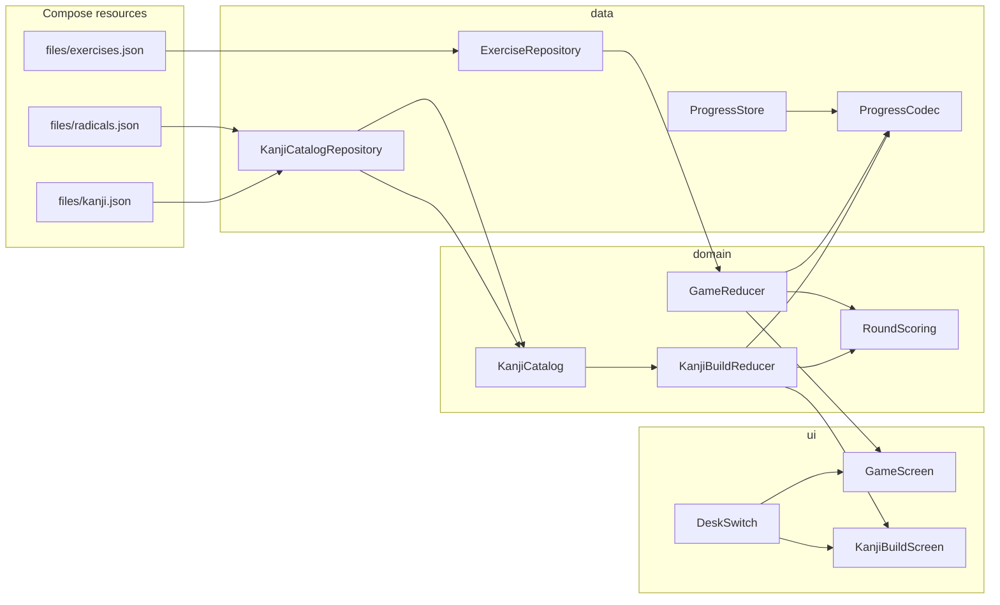
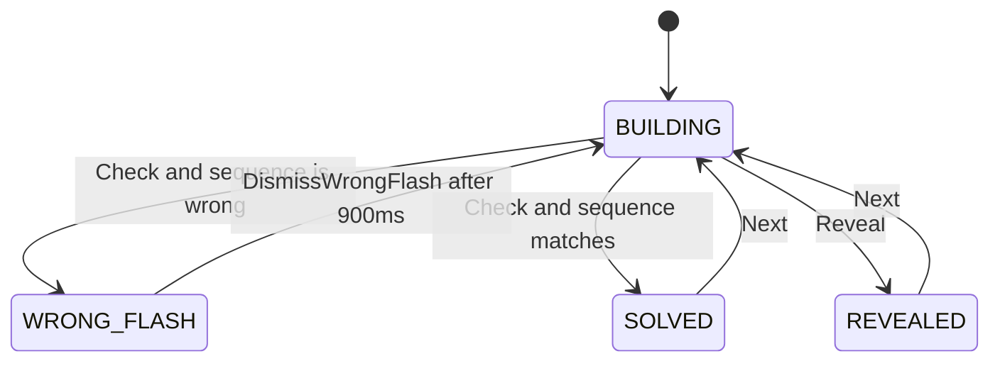
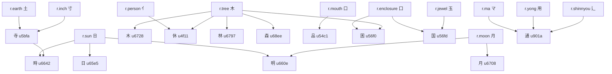

# Build the Kanji — radical graph and ordered-component desk

| Field | Value |
| --- | --- |
| **Document** | Design for GitHub issue #4 |
| **Author** | Design (issue #4) |
| **Date** | 2026-11-07 |
| **Status** | Draft |
| **Repo** | `JapaneseLanguageGame` (Kotlin Multiplatform + Compose: `commonMain`, `jvmMain`, `wasmJsMain`) |
| **Parent** | Issue #3 (radical → kanji → vocab → sentence ladder) |
| **Implements** | Issue #4 only. #5, #6, and #9 are seams, not this project. |

This is an implementation plan. It does not add a backend, an account system, or a second Gradle module. The running sentence drill stays the source of truth for phases, scoring, and persistence style.

The numbered design notes linked from `docs/README.md` (`docs/00-overview.md` through `docs/05-roadmap.md`, `docs/deploy-amplify.md`) are not in the tree. Behavior below is taken from the Kotlin sources and from `docs/issue-04-…`, `docs/KanjiBuild.md`, `docs/issue-03`, `docs/issue-05`, `docs/issue-06`, and `docs/issue-09`.

---

## Overview

Issue #4 adds a second desk next to Sentence Builder (文を作ろう). The learner sees an English keyword, such as "pass through", and taps radical or sub-kanji chips in the order a writer **starts** each component. For 通 the accepted sequence is `マ → 用 → 辶`. The road radical is last because that is when its first stroke is written, not because the learner traced ten strokes.

The desk reuses the sentence round's phase machine, streak scoring, shuffle guard, chip visual language, and the single local progress document. It does **not** stuff kanji into `Exercise` or call `GameReducer.place`. That function rejects a second use of the same tile id (`GameReducer.kt` lines 159–164). `GameReducer.isCorrect` (lines 109–119) accepts an exact tile-id sequence, or the same surfaces in the same order. Identical surfaces are interchangeable (`duplicateSurfacesAreInterchangeable`). Order is not ignored: は then を is not a correct permutation of を then は. A radical is a type that 森 uses three times. Forcing that through `Tile` / `TileRole` would paint grammatical roles onto graphemes and would add dead chips to `LevelSelector`, which iterates `JlptLevel.entries`. Cloned 木 tiles would also be interchangeable by surface, so the order of identical copies could not be graded. That argument is in alternatives.

v1 ships a hand-authored graph of **12 radicals and 13 kanji**, including 通, plus the dependency and repeat cases the issue asks about. It does not ship the Jōyō list. Mastery is a schema and a pure function that #9 can grow into intervals. With no SRS desk present, gating defaults to **off**: the authored catalog is the learned pool, so the new desk is playable the moment it merges.

---

## Background & Motivation

### What the app is today

One window, one screen, no navigation graph.

| Concern | What exists |
| --- | --- |
| Rules | `GameReducer.start` / `reduce` in `domain/GameReducer.kt`. Pure. `ExerciseCatalog` is passed in, not loaded, by the reducer. |
| Rounds | `RoundPhase`: `BUILDING`, `WRONG_FLASH`, `SOLVED`, `REVEALED`. A wrong check does not clear `placed`. `DismissWrongFlash` only restores `BUILDING`. The 900 ms flash lives in `LoadedGame` (`JapaneseLanguageGameApp.kt`), not in the reducer. |
| Scoring | On a correct check, `score += 1 + min(streak, 5)`, then `streak += 1`, and `best` rises. A miss or a reveal zeros `streak` and does not change `score`. Locked by `GameReducerTest.scoringMatchesTheHtmlStreakBonus` and `revealIsAMissAndDoesNotAddScore`. |
| Tiles | `Tile(id, surface, reading, role)`. `WordTile` is a drag-or-tap chip. Furigana only when `Tile.showsReading` (surface hits `Tile.KANJI`, U+4E00..U+9FAF, and `reading` is non-blank). |
| Content | `ExerciseRepository` reads `files/exercises.json` via `Res.readBytes`. `parse` is synchronous and throws `IllegalArgumentException` through `require`. The catalog is 120 exercises, 40 each of N5/N4/N3. 697 correct tile instances, 335 unique surfaces, **234** of those surfaces contain at least one CJK unified ideograph. There is no `ExerciseRepositoryTest` class; catalog locks live in `GameReducerTest`. |
| Progress | `PersistedProgress` is `{ jlpt, furigana, distractors, score, streak, best }`. `ProgressCodec` pretty-prints, encodes defaults, ignores unknown keys, and falls back to defaults on corrupt input. JVM: `FileProgressStore` at `$XDG_CONFIG_HOME/JapaneseLanguageGame/progress.json` or `~/.config/JapaneseLanguageGame/progress.json`, overridable with `JAPANESE_LANGUAGE_GAME_HOME`. Wasm: `KeyValueProgressStore` / `BrowserLocalStorage`, key `JapaneseLanguageGame.progress`. Deck index is not saved. |
| Save path | The only `GameController` (`class GameController` in `JapaneseLanguageGameApp.kt`; it is public) calls `state.toPersisted()` and `store.save` when that value changes. A failed save is a `println`. There is no second writer today. The constructor seeds `lastSaved` from `state.toPersisted()`, which is a fresh six-field object. |
| Shell | `jvmMain` `Main.kt` title `Sentence Builder — 文を作ろう`. Wasm title is the same string in `src/wasmJsMain/resources/index.html`. `WebApp` preloads `Res.font.NotoSansJP_Regular` and `Res.font.NotoSansJP_SemiBold` and will wait up to 5 seconds. |
| Levels | `JlptLevel.N2.playable` is false. `GameReducer.selectLevel` ignores it. There is no N1. |

`docs/issue-03` states the gap directly: kanji exist only as tile surfaces. Nothing gates a radical, a character, or a word.

### Why a new desk, not a new app

The pedagogy in #4 only works if the interaction stays the one players already know: a prompt, a bank, an ordered bar, Check / Hint / Reveal / Next, a streak. WaniKani-style reveal-the-answer cards would throw away `GameScreen`. A stroke-tracing canvas would throw away tiles and would need drawing code neither target has.

### Font constraint discovered while reading the bundle

`src/commonMain/composeResources/font/NotoSansJP-Regular.ttf` and `NotoSansJP-SemiBold.ttf` are about 315 KB each. Both name tables identify the face as **Noto Sans JP Thin** (name IDs 1, 4, and 6), subfamily Regular. The cmap is format 4 with **697** code points.

Probed against `exercises.json` and the UI strings:

- 225 distinct CJK characters appear in exercise surfaces. **109 are absent** from the cmap, including 一, 木, 口, 国, 明.
- Kana in the exercises are covered. `文を作ろう` and `ふりがな` are covered.
- `漢字` is **not** covered, so a title that uses those two characters tofus until the font grows.
- 休, 五, 行, 日, 月, and マ are covered. 通, 用, 辶, 亻, 囗, 龶 are not.

`FuriganaLabel` and `WordTile` set `fontFamily` to `LocalGameFont`, which is only this family. Wasm has no system CJK fallback to rely on. Any new glyph is invisible until the subset grows. That is a prerequisite for the desk, not a follow-up polish task.

Skiko on the desktop might fall back to a system font for the 109 missing exercise kanji. Wasm will not. The font pull request below repairs the exercise holes in the same subset pass, because the inputs are the same cmap union. That is a defect fix bundled with #4, not a new product surface.

---

## Goals & Non-Goals

### Goals

1. A **Build the Kanji** desk (漢字を作ろう) that is a sibling of `GameScreen`, switched locally, sharing one `ProgressStore`.
2. Ordered component checks for one primary sequence, with optional alternates shaped like `Exercise.answers`.
3. Authored `radicals.json` and `kanji.json` beside `exercises.json`, validated the way `ExerciseRepository.parse` validates tiles.
4. A dependency DAG: every `components[]` id is a radical or another kanji; the shipped file is topologically ordered; cycles fail parse.
5. Repeat taps for 林 / 森 / 品 without cloning inventory chips.
6. Enclosure and しんにょう modeled as "which component's first stroke comes first", not as split open/close tokens.
7. A tray policy that shows the whole learned bank at the v1 size and deals required-plus-distractors once that bank is large, so #9 does not rewrite the dealer.
8. A progress document #9 can fill without a migration: `items["<kind>:<id>"]` with `stage`, `due`, `streak`, `last`.
9. Copyright-safe hooks for #5 (`references[]`, short keywords, hint, notes). No book prose, no video, no in-app browser.
10. A `byCharacter` lookup #6 can call later. No vocab file, no change to which sentences are served.
11. Tests named and specified. Not run by this design.

### Non-goals

- Implementing #5 (reference buttons, personal notes, YouTube, WebView).
- Implementing #6 (`vocab.json`, dimming sentence tiles, "words in this sentence").
- Implementing #7 or #8.
- Implementing #9's intervals, export/import, radical-introduction desk, or sentence-queue gating. `GameReducer.selectLevel` stays a free N5/N4/N3 choice.
- Full Jōyō (2,136) or a complete JLPT kanji list.
- Freehand stroke tracing, SVG decomposition, or a glyph compositor that draws 通 out of positioned outlines.
- Drag-and-drop on the kanji desk. Tap only. Sentence drag stays as it is.
- Shape or stroke-count tabs. See open question 4.
- A new module, server, account, analytics pipeline, or feature-flag service.
- Auto-collapsing a kanji to a coarser sub-kanji because the learner happens to know it.
- Persisting the queue index. Sentence Builder does not; this desk does not.
- Adding `N1` to `JlptLevel`, or enabling `N2` on the sentence selector.

---

## Proposed Design

### Desk topology



Both desks are composables under the existing `JapaneseLanguageGameApp`. `GameScreen` does not gain a kanji mode flag. A mode flag would thread `KanjiBuildState` through sentence slots (`SentenceBar`, distractor toggle, furigana) that do not apply.

### Single writer for progress

`GameController` is the only saver today. Two controllers would clobber each other: `toPersisted()` builds a sentence-only document, and `encodeDefaults = true` would write the kanji fields back out as zeros.

Replace it with one `AppController` in `JapaneseLanguageGameApp.kt`. PR 2 changes the existing controller's initializer and sentence overlay first, before the kanji desk exists. PR 6 renames that class to `AppController` and adds the kanji writer. There is still one writer.

`GameReducer.start` copies only `jlpt`, `furigana`, `distractors`, `score`, `streak`, and `best`. It is not the hydration path for `kanjiScore`, `desk`, `gating`, or `items`. The controller keeps the sanitized load in a `document` field and never rebuilds that document from a default `PersistedProgress()`.

```kotlin
class AppController(
    private val exercises: ExerciseCatalog,
    private val kanji: KanjiCatalog,
    private val store: ProgressStore,
    initial: PersistedProgress, // already ProgressCodec.decode / sanitize
) {
    private var document: PersistedProgress = initial
    private var lastSaved: PersistedProgress = initial

    var desk by mutableStateOf(parseDesk(initial.desk))
    var sentence by mutableStateOf(GameReducer.start(exercises, initial))
    var kanjiState by mutableStateOf(
        KanjiBuildReducer.start(
            catalog = kanji,
            saved = initial,
            items = initial.items,
            gating = parseGating(initial.gating),
        )
    )
}
```

There is one `items` map, and it lives on `document`. Do not keep a second `var items`. `initial.items` is read only while constructing `kanjiState`. Every later `reduce` reads `document.items` after the previous dispatch has assigned `document`.

Do not seed `lastSaved` with `sentence.toPersisted()` or with `toPersisted()`'s default base. That is today's constructor (`lastSaved = state.toPersisted()`), and it drops `items`, `desk`, `gating`, and the kanji scores before the first event. The first `dispatch` then saves the stripped document, because `encodeDefaults = true` writes the missing fields as zeros and empty maps.

Assign the reduced value before the overlay, and assign the overlay before `save` returns. The next event must not see the pre-event state or the pre-event map.

PR 2 does not have `kanjiState`. It changes today's `GameController.dispatch` (`JapaneseLanguageGameApp.kt` lines 53–65), which already reduces into `next` and saves `next.toPersisted()` with no base. The new body overlays that same `next`, not the pre-event `state`:

```kotlin
fun dispatch(event: GameEvent) {
    val next = GameReducer.reduce(state, event, catalog)
    state = next
    document = next.toPersisted(document)
    save()
}
```

PR 6 renames the class and splits the two desks. The order is the same. `dispatchSentence` does not replace `items` or the kanji scores. `dispatchKanji` does not replace `jlpt`, `furigana`, `distractors`, `score`, `streak`, or `best`.

```kotlin
fun dispatchSentence(event: GameEvent) {
    val next = GameReducer.reduce(sentence, event, exercises)
    sentence = next
    document = next.toPersisted(document)
    save()
}

fun dispatchKanji(event: KanjiBuildEvent) {
    val step = KanjiBuildReducer.reduce(
        state = kanjiState,
        event = event,
        catalog = kanji,
        items = document.items,
        gating = parseGating(document.gating),
    )
    kanjiState = step.state
    document = step.overlayOn(document)
    save()
}
```

`save` writes `document` when it differs from `lastSaved`, then sets `lastSaved = document`. Both field assignments happen before `save` returns and before any following event. The next `dispatchKanji` passes the `document.items` this call just stored. It does not pass a map captured at construction. `Next` does not change mastery, so it returns the map it was given. If that map is still empty from before the check, `withKanji` replaces `document.items` with `{}` and deletes `kanji:u901a`.

`switchDesk` assigns the observable desk and the document together. `document` is a private `var`. Compose does not recompose when it changes. `DeskSwitch` and the screen branch read `controller.desk`, not `document.desk`.

```kotlin
fun switchDesk(next: Desk) {
    desk = next
    document = document.copy(desk = next.wire)
    save()
}
```

Assign `desk` before `save`. A chip that only copies `document.desk` persists `"kanji"` and leaves Sentence Builder on screen until the next process start. Compare the whole document to `lastSaved`. Do not skip the save because the score triples are equal. A desk-only change must hit the disk. The same persistence rule applies in PR 2 once `desk` exists, even though nothing in the UI sets it yet: a test that loads `desk = "kanji"` and dispatches a sentence `Place` still saves `"kanji"`. The visible assignment is PR 6, which is when `switchDesk` and `DeskSwitch` exist.

Load failure of `kanji.json` / `radicals.json` disables the kanji desk only. A failed `exercises.json` still blocks the app, which is the current `JapaneseLanguageGameApp` behavior. Sentence Builder must keep working if the new catalog is bad.

`GameState.toPersisted()` currently returns a fresh `PersistedProgress` (Models.kt lines 159–166). Change it so it overlays sentence fields onto a base document. `withKanji` takes the four values PR 2 already owns. It does not take `KanjiStep`. `KanjiStep` holds a `KanjiBuildState`, and that state holds a `SoftBand?`. `SoftBand` arrives in PR 3 and `KanjiStep` in PR 5. A `KanjiStep` parameter would make PR 2 depend on both.

```kotlin
fun GameState.toPersisted(base: PersistedProgress = PersistedProgress()): PersistedProgress =
    base.copy(
        jlpt = jlpt.name,
        furigana = furigana,
        distractors = distractorsEnabled,
        score = score.coerceAtLeast(0),
        streak = streak.coerceAtLeast(0),
        best = best.coerceAtLeast(0),
    )

fun PersistedProgress.withKanji(
    score: Int,
    streak: Int,
    best: Int,
    items: Map<String, ItemRecord>,
): PersistedProgress = copy(
    kanjiScore = score.coerceAtLeast(0),
    kanjiStreak = streak.coerceAtLeast(0),
    kanjiBest = best.coerceAtLeast(0),
    items = items,
)
```

`withKanji` does not take a `desk` argument. Desk changes go through `switchDesk`, so a kanji `Check` cannot overwrite `desk` with a stale default. The default argument on `toPersisted` exists so a unit test can still build a sentence-only value. Production call sites pass `document`. `ItemRecord` lives in `Mastery.kt`, which PR 2 adds. The overlay test builds the four arguments by hand and does not import the reducer.

PR 5 is what unpacks the step. It adds this next to `KanjiStep`, and it is the only production call that passes a step's fields into `withKanji`:

```kotlin
fun KanjiStep.overlayOn(base: PersistedProgress): PersistedProgress =
    base.withKanji(state.score, state.streak, state.best, items)
```

PR 6 calls `step.overlayOn(document)` after `kanjiState = step.state`. The reducer does not call it.

A base with `kanjiScore = 4` and a non-empty `items` map survives `toPersisted(base)` after a sentence `Place`. A base with `score = 9` and `furigana = false` survives `withKanji`. Two controller tests lock the handoff, which the reducer test does not see. `GameControllerTest.sentenceCheckSavesTheReducedScore` (PR 2) places a correct sentence and dispatches `Check`. The saved `score` is the post-check value, and a preloaded `kanjiScore` of 4 is still 4. `AppControllerHandoffTest.checkThenNextKeepsIntroducedItem` (PR 6) uses a catalog whose only kanji is `u901a`, gating off, and an empty `items` map. A correct `Check` then `Next` still has `kanji:u901a` on the saved document. Both are jvmTest. Neither opens a window or adds a Compose test rule. `mutableStateOf` is read outside composition, which `GameController` already does.

`KanjiStep.items` is the input map, or that map with exactly one key replaced (`kanji:<current id>`). It is never a map that contains only the updated key. Returning `mapOf("kanji:u901a" to record)` would delete every other key on the next save. Events that do not change mastery return the same map. `KanjiBuildReducer.start` reads `saved.kanjiScore`, `saved.kanjiStreak`, and `saved.kanjiBest` (each coerced at 0 or above). `GameReducer.start` does not.

### Phases, keys, and scoring

Reuse `RoundPhase` unchanged. `KanjiBuildState` carries the same `phase`, `hintShown`, and `feedbackToken` as `GameState`. Input is locked unless `phase == BUILDING`, matching `GameState.inputLocked`.

The 900 ms flash keeps today's guard. `LoadedGame` keys `LaunchedEffect` on `(feedbackToken, phase)`, waits, then dispatches `DismissWrongFlash` only if both still match:

```kotlin
LaunchedEffect(state.feedbackToken, state.phase) {
    if (state.phase != RoundPhase.WRONG_FLASH) return@LaunchedEffect
    val token = state.feedbackToken
    delay(900)
    if (controller.state.feedbackToken == token && controller.state.phase == RoundPhase.WRONG_FLASH) {
        controller.dispatch(GameEvent.DismissWrongFlash)
    }
}
```

Per desk, key the effect on `(visibleDesk, thatDesk.feedbackToken, thatDesk.phase)`. After the delay, dismiss only if the visible desk is still `visibleDesk`, that desk's `feedbackToken` is still `token`, and that desk's `phase` is still `WRONG_FLASH`. A second wrong check bumps the token, so the in-flight effect must not dismiss the new flash. `DeskSwitch` stays enabled during `WRONG_FLASH` (leaving a flash is allowed; the action buttons on the card stay locked). Switching desks cancels the effect. Cancellation must not dispatch for the desk that is now visible, and it must not dismiss the hidden desk. The hidden desk stays in `WRONG_FLASH` with its `placed` chips until the learner returns and that desk's own effect runs to completion.

Extract the formula that `GameReducer.check` and `reveal` inline today:

```kotlin
object RoundScoring {
    data class Score(val score: Int, val streak: Int, val best: Int)

    fun correct(current: Score): Score {
        val streak = current.streak + 1
        return Score(
            score = current.score + 1 + minOf(current.streak, 5),
            streak = streak,
            best = maxOf(current.best, streak),
        )
    }

    fun miss(current: Score): Score = current.copy(streak = 0)
}
```

`GameReducer` calls this and nowhere else changes. `GameReducerTest.scoringMatchesTheHtmlStreakBonus` must stay byte-for-byte in its assertions. Kanji uses the same object against `kanjiScore` / `kanjiStreak` / `kanjiBest`. A kanji miss must not zero the sentence streak. Those are different fields on purpose: one desk's miss is not the other desk's miss.

Keyboard bindings match `handleKey`: Enter checks when `BUILDING` and `placed` is non-empty, Enter or N advances from `SOLVED` / `REVEALED`, H hints, Esc clears. Modifiers still pass through. The reset dialog still swallows keys.

### What a round is



`placed` is a list of component ids, repeats allowed. It is **not** cleared on a wrong check.

| Event | When it does something | Otherwise |
| --- | --- | --- |
| `Place(id)` | `BUILDING`, queue non-empty, `id` in the current tray. Append `id`. The same id may already be in `placed`. | No-op |
| `RemoveAt(index)` | `BUILDING` and `index` is in `placed`. Later entries shift down, same as `GameReducer.removeAt`. | No-op |
| `Clear` | `BUILDING`. `placed = empty`. | No-op |
| `Check` | `BUILDING`, queue non-empty, `placed` non-empty. Match → `SOLVED` and `RoundScoring.correct`. Else `WRONG_FLASH`, `RoundScoring.miss`, `feedbackToken++`. `placed` is kept on a miss. | No-op, including an empty `placed` |
| `Hint` | `BUILDING` and queue non-empty. `hintShown = true`. | No-op |
| `Reveal` | `BUILDING` and queue non-empty. `placed = entry.components` (primary, never an alternate), `REVEALED`, `RoundScoring.miss`. | No-op |
| `Next` | `SOLVED` or `REVEALED` only, same predicate as `GameReducer.next` (lines 204–206). See begin-round below. | No-op, including `BUILDING` and `WRONG_FLASH` |
| `SelectBand` | Any phase, including `WRONG_FLASH`. `buildQueue` for that band, then begin-round at index 0. Scores unchanged. | — |
| `ResetStats` | Any phase. Zero kanji score, streak, and best. Do not touch `items`, sentence stats, or the current round. | — |
| `DismissWrongFlash` | `WRONG_FLASH` → `BUILDING`. `placed` stays. | No-op |

`Next` during `WRONG_FLASH` must not advance. The state diagram has no such edge, and the keyboard only sends `Next` from `SOLVED` or `REVEALED`. A wrong check leaves `placed` so the learner can edit after the flash. Advancing on the flash would skip that retry.

**Begin-round** is the one transition used by `start`, by `Next` when the phase allows it, by wrap, and by `SelectBand`. It matches `GameReducer.beginRound` (clears `placed`, clears `hintShown`, sets `BUILDING`, rebuilds the dealt order) with a tray instead of `tileOrder`:

- `placed = empty`
- `hintShown = false`
- `phase = BUILDING`
- `tray` recomputed for `queue[index]` by `dealTray`. A mid-queue `Next` does this. It does not keep the previous entry's tray. Leaving 日's chips up for 時 is a bug.
- Scores unchanged. `feedbackToken` unchanged.
- Queue order unchanged, except when wrap or `SelectBand` calls `buildQueue` first and then begin-round on that new list.

`start` is begin-round at index 0 on the queue from `buildQueue(catalog, band = null, gating, mastery)`. It copies `kanjiScore` / `kanjiStreak` / `kanjiBest` off `saved` before that.

On an empty queue (`kanjiId == null`): `Place`, `RemoveAt`, `Check`, `Reveal`, `Hint`, `Clear`, and `Next` no-op and do not throw. `tray` is empty. `SelectBand` and `ResetStats` still run. The UI shows the empty copy from the state table. No `entry.components` lookup on a null id.

Wrap: if `Next` is legal and `index >= queue.lastIndex`, call `buildQueue` again (so gating can admit kanji that became eligible this pass), then begin-round at index 0. Do not shuffle that list. If `Next` is legal and the index is not last, begin-round at `index + 1` on the **same** queue. Membership is not rebuilt on a mid-queue `Next`. That is the gating delay from the queue section, and it is separate from recomputing `tray`.

The structure frame is the placed area. There is no second linear "sentence bar". Slot `i` shows `placed[i]`. Tapping a filled slot sends `RemoveAt(i)`. If the learner overshoots, slots past `components.size` render in an "extra" row under the frame so they can be removed. Check still fails. The frame does not pre-validate a tap. Sentence Builder does not either.

Help line on this desk, not the sentence help line: "Tap a radical to add it. Tap a placed part to take it back; later parts move up. The road radical and the closing side of a box are not separate taps."

### Prompt and answer visibility

During `BUILDING` and `WRONG_FLASH` the target character is **not** on screen. The prompt is `keywords.first()` at the same scale as `exercise.english` (26 sp, semi-bold). Further keywords sit on a muted line ("Also: day"). Showing 通 would turn the round into a copying task.

On `SOLVED` or `REVEALED`, the character is drawn at about 64 sp beside the frame, and `notes` shows under the feedback title the way `exercise.notes` does. Reveal's feedback title stays a miss: "Answer revealed. This counts as a miss."

Hint copy is a structural one-liner we write (`KanjiEntry.hint`). It is not a mnemonic story. The Hint button reveals it in place, same layout as `GameScreen`'s hint line.

### Structure frame

`ui/StructureFrame.kt`. Layout is authored, not inferred from the glyph.

| `KanjiLayout` | Slots | v1 users |
| --- | --- | --- |
| `SINGLE` | 1 box | 日, 月, 木 |
| `HORIZONTAL` | left to right, count ≥ 2 | 明, 休, 林, 時 |
| `VERTICAL` | top to bottom, count ≥ 2 | 寺 |
| `TRIAD` | exactly 3: top, bottom-left, bottom-right | 森, 品 |
| `ENCLOSURE` | exactly 2: frame, then inner | 困, 国 |
| `SHINNYOU` | count ≥ 2; all but the last stacked; the last is a full-width bottom slot | 通 |

`KanjiCatalogRepository.parse` rejects a layout whose arity does not match `components.size`.

Enclosure drawing: slot 0 does not paint a giant 囗 on top of slot 1. The frame border is the enclosure affordance, and it is chrome, not an answer. Slot 0's glyph and caption are `placed[0]`, and slot 1's inner glyph is `placed[1]`, each resolved through `KanjiCatalog.resolve`. Do not paint `r.enclosure`'s glyph unless that id is actually in the slot. A first tap of 木 on 困 draws 木 in slot 0, not 囗. An empty slot stays an index. This is the same rule as every other layout: slot `i` shows `placed[i]` or nothing.

The enclosure border follows the phase. `Palette.accent` is used only when `phase == BUILDING` and `placed` is non-empty. That accent does not mean the enclosure radical was correct. It only means a part has been placed and the round is still open. Empty `BUILDING` keeps `Palette.borderStrong`. `WRONG_FLASH` and `REVEALED` stay `Palette.bad` even when `placed` is still filled. `SOLVED` stays `Palette.good`. Accent does not override those phase colors.

`SHINNYOU` for 通 is three rows: マ, 用, then 辶. It is a schematic, not a calligraphic 辶 wrapping the body. That is the v1 reading of "highlight each component's position inside the kanji frame". A real outline compositor is a non-goal.

Empty slots show their index. They do reveal the component **count** and the rough geometry. That is accepted. The sentence bar does not pre-print word count; this desk does, because the pedagogy is the shape of the character. They do not reveal which radical belongs in the slot.

Slot fills follow `SentenceBar`: `Palette.slot` while building, `Palette.goodBg` / `Palette.good` when solved, `Palette.badBg` / `Palette.bad` on wrong flash and reveal. The enclosure border is the exception only during a non-empty `BUILDING` phase, where it is `Palette.accent` instead of `Palette.borderStrong`. Once the phase is `WRONG_FLASH`, `REVEALED`, or `SOLVED`, the border uses the same bad or good token as the fill. Reuse `Palette`. No new tokens.

### Tray chips

`ui/RadicalTile.kt`. Do not route radicals through `WordTile`.

`WordTile` takes a `Tile`, turns particle roles blue, runs a drag gesture detector, and only shows a caption when `showsReading` is true. Radical captions are English ("tree", "road"). マ is katakana, so it is outside `Tile.KANJI` and would not show a caption. 亻 is a kanji-range character and would. The two shapes would not match. Drag plus "tap again to place a second 木" is also a gesture conflict: `WordTile` treats a second hit on a used id as a no-op via the reducer.

`RadicalTile` copies the chip chrome that is already in `WordTile`: `RoundedCornerShape(10.dp)`, `Palette.tile`, `Palette.borderStrong`, accent border on hover, 18 sp glyph, `LocalGameFont`. Tap only. The chip is **never** dimmed because it was used. Caption under the glyph is `keywords.first()` for a radical and the same for a sub-kanji, in `Palette.muted` at about 11 sp.

A tray entry whose id resolves to a **kanji** (寺 inside 時) uses the same chip with a `Palette.accent` border so it is visibly "a character you build", not a third radical color. Do not reuse `Palette.particle`. That blue means particles on the other desk.

Semantics: content description `"木, tree"` or `"寺, temple"`. Slots: `"slot 2 of 3, empty"`.

`StatPill` and `ActionButton` are private in `GameScreen.kt`. Move those two composables, unchanged in look, to `ui/DeskChrome.kt` and call them from both screens. Do not move `Pool`, `SentenceBar`, or the drag ghost.

### Reducer and catalog

New types live in `domain/KanjiModels.kt`, `domain/Mastery.kt`, and `domain/KanjiBuildReducer.kt`. `KanjiCatalog` sits next to `ExerciseCatalog` in spirit but in its own file, `domain/KanjiCatalog.kt`, so `GameReducer.kt` does not become a second junk drawer.

```kotlin
class KanjiCatalog(
    val radicals: List<Radical>,
    val kanji: List<KanjiEntry>,
) {
    fun radical(id: String): Radical?
    fun entry(id: String): KanjiEntry?
    fun byCharacter(character: String): KanjiEntry?
    fun forBand(band: SoftBand): List<KanjiEntry>
    fun resolve(id: String): ComponentRef?
}

sealed interface ComponentRef {
    data class RadicalRef(val radical: Radical) : ComponentRef
    data class KanjiRef(val entry: KanjiEntry) : ComponentRef
}
```

`byCharacter` is the #6 seam. Parse fails if two entries share a character.

```kotlin
data class KanjiBuildState(
    val band: SoftBand?,
    val score: Int,
    val streak: Int,
    val best: Int,
    val queue: List<String>,
    val index: Int,
    val tray: List<String>,
    val placed: List<String>,
    val phase: RoundPhase,
    val hintShown: Boolean,
    val feedbackToken: Int,
) {
    val kanjiId: String? get() = queue.getOrNull(index)
    val inputLocked: Boolean get() = phase != RoundPhase.BUILDING
}

sealed interface KanjiBuildEvent {
    data class Place(val componentId: String) : KanjiBuildEvent
    data class RemoveAt(val index: Int) : KanjiBuildEvent
    data class SelectBand(val band: SoftBand?) : KanjiBuildEvent
    data object Clear : KanjiBuildEvent
    data object Check : KanjiBuildEvent
    data object Hint : KanjiBuildEvent
    data object Reveal : KanjiBuildEvent
    data object Next : KanjiBuildEvent
    data object DismissWrongFlash : KanjiBuildEvent
    data object ResetStats : KanjiBuildEvent
}

data class KanjiStep(
    val state: KanjiBuildState,
    val items: Map<String, ItemRecord>,
)
```

`band == null` means All. The band filter is view state. It is not written to disk. Relaunch returns to All, the same way relaunch does not restore the sentence index.

`items` stays **out** of `KanjiBuildState`. It is the shared mastery map #6 and #9 will also write. The reducer is:

```kotlin
fun start(
    catalog: KanjiCatalog,
    saved: PersistedProgress,
    items: Map<String, ItemRecord>,
    gating: Gating,
    shuffler: Shuffler = DefaultShuffler,
): KanjiBuildState

fun reduce(
    state: KanjiBuildState,
    event: KanjiBuildEvent,
    catalog: KanjiCatalog,
    items: Map<String, ItemRecord>,
    gating: Gating,
    shuffler: Shuffler = DefaultShuffler,
): KanjiStep
```

`start` copies `saved.kanjiScore`, `saved.kanjiStreak`, and `saved.kanjiBest`, forces `band = null`, builds the queue, and begin-round deals the tray for index 0. It does not read sentence `score`. `reduce` returns a `KanjiStep` whose `items` map is the input map plus at most one replaced key, as specified under mastery writes. `Gating` is `OFF` or `PREREQUISITES`, parsed from the progress string. The reducer does not read the clock and does not write `due`.

#### Correctness

```kotlin
fun isCorrect(entry: KanjiEntry, placed: List<String>): Boolean =
    placed == entry.components || entry.alternates.any { it == placed }
```

Exact id lists. No surface interchange. 月-the-radical and a later kanji that happens to look like 月 must not compare equal by glyph. Identity items (日 = `[r.sun]`) are a one-id list, which is exact.

Reveal places `entry.components`, analogous to `exercise.answers.first()` in `GameReducer.reveal`.

v1's resource ships `alternates: []` on every entry. The reducer and the parser still accept alternates so a later granularity (甬 as one chunk versus マ + 用) is data, not a new rules pass. An alternate must resolve under the same id rules and must not equal the primary.

#### Queue

Production order is **catalog order**, not a shuffle.

`GameReducer.start` shuffles because sentence items do not depend on each other. Kanji do. Shuffling would put 時 before 寺 and hand the learner a 寺 chip they have never built. v1's file is authored in dependency order. `next` wraps without reshuffling so that order survives a second pass.

`Shuffler` is still a parameter. It is used for the **tray**, not the queue. Tests inject the same kind of stable shuffler `GameReducerTest` uses locally.

```kotlin
fun buildQueue(
    catalog: KanjiCatalog,
    band: SoftBand?,
    gating: Gating,
    mastery: MasteryLookup,
): List<String> = catalog.kanji
    .asSequence()
    .filter { band == null || it.band == band }
    .filter { gating == Gating.OFF || eligible(it, catalog, mastery) }
    .map { it.id }
    .toList()
```

The queue is built in `start`, on `SelectBand`, and when `Next` wraps. It is not rebuilt on every correct check, and it is not rebuilt on a mid-queue `Next`. With gating off that is invisible. With gating on, a kanji that becomes eligible mid-pass appears on the next wrap or band change. That delay is deliberate and tested. Rebuilding mid-queue shifts indexes under the learner.

The band filter changes queue membership only. It does not filter tray ids. `forBand(N5)` contains 時 (`u6642`) and does not contain 寺 (`u5bfa`, N2). The tray for 時 still appends `u5bfa`, because 寺 is a required component and the tray rule does not consult the selected band. An implementer who also filters tray ids by band makes 時 unsolvable on the N5 chip. That is the catalog's one kanji→kanji edge. `n5BandStillTraysTemple` locks it.

```kotlin
fun eligible(entry: KanjiEntry, catalog: KanjiCatalog, mastery: MasteryLookup): Boolean =
    entry.components.all { id ->
        when (catalog.resolve(id)) {
            is ComponentRef.RadicalRef -> mastery.stage(ItemKind.RADICAL, id) != MasteryStage.NEW
            is ComponentRef.KanjiRef -> mastery.stage(ItemKind.KANJI, id) != MasteryStage.NEW
            null -> false
        }
    }
```

`NEW` and a missing map entry are the same. `LEARNING`, `REVIEWING`, and `MASTERED` all count as known. v1 never writes the last two. If a hand-edited file contains them, they still unlock.

#### Tray

```kotlin
object KanjiBuildReducer {
    const val WHOLE_BANK_MAX: Int = 24
    const val DISTRACTOR_CAP: Int = 3
}
```

`DISTRACTOR_CAP` matches the `3` in `GameReducer.activeTiles`. There is no `FallbackParticles` equivalent. If the learned pool has fewer than three non-required radicals, the tray is shorter. The dealer never invents a radical.

Learned radical ids, gating off: every radical in `radicals.json`, catalog order. Gating on: radicals whose stage is not `NEW`.

Let `required` be `entry.components.distinct()`, first-seen order. 森 contributes `r.tree` once. The answer list still contains it three times.

**Whole bank** when `learned.size <= WHOLE_BANK_MAX` (v1 is 12, so this is the production path):

- Tray ids = all learned radical ids, in catalog order. The selected `SoftBand` is not applied to this list.
- Then append any required id that is not already there, including a kanji whose own band is not the band being played. That is how 寺 (`u5bfa`, N2) enters the tray for 時 while the N5 queue does not contain `u5bfa`. Append it once. Other kanji do **not** join the bank. Dumping every learned kanji into the tray would spoil later items and will not scale.
- Pass the list through `GameReducer.shuffledTileOrder(tray, listOf(required), shuffler)`.

`shuffledTileOrder` (lines 89–102) reshuffles up to eight times when the whole list equals a canonical answer. A 12-chip tray will not equal a 2-id answer, so the guard rarely fires. It does fire for a one-chip tray that is exactly `[r.sun]`, and then gives up the same way a one-tile sentence does. Reusing the function is the point. Do not fork a second shuffle policy.

**Dealt tray** when `learned.size > WHOLE_BANK_MAX`:

- Start from `required` (radicals and any sub-kanji).
- Distractor pool = learned radicals not in `required`. Sub-kanji the learner knows are not used as distractors in v1. They are spoilers with captions.
- Sort that pool by minimum absolute stroke-count distance to any required **radical**, then by catalog order. `STROKE_WINDOW` is not a hard filter. Proximity only picks **which** three. Always take up to three if they exist.
- Shuffle `required + extras` with `shuffledTileOrder`, canons = `[required]`.

Stroke distance uses `Radical.strokeCount`. Kanji entries do not need a stroke count in v1.

`Place` ignores an id that is not in `state.tray`.

#### Mastery writes (the #9 seam, not an SRS)

```kotlin
fun interface MasteryLookup {
    fun stage(kind: ItemKind, id: String): MasteryStage
}
```

Keys are `"radical:$id"`, `"kanji:$id"`, `"vocab:$id"`, `"sentence:$id"`. #9's sketch. Vocab and sentence keys are legal in the sanitizer and unused by this desk.

On **correct** check of kanji `u901a`:

- Desk score updates through `RoundScoring`.
- Build the returned map as `items + ("kanji:u901a" to updatedRecord)`. Every other key in the input map is still there. Do not allocate a fresh map from the one kanji just graded.
- That record: if absent or `stage == new`, set `stage` to `learning`. Otherwise leave `stage` alone, including a hand-edited `reviewing` or `mastered`.
- Increment that record's `streak`.
- Leave `due` and `last` as they were on the previous record (null if there was none). v1 has no clock. Do not add `kotlinx-datetime`; it is not a commonMain dependency we should take for a null field.

On **wrong** check or **reveal**:

- Desk streak zeros. Desk score unchanged.
- If the item record exists, set its `streak` to 0 and do not change `stage`.
- If it does not exist, do not create one. A reveal is not an introduction.

Radical records are not written by this desk. There is no radical flashcard round to introduce them. That is why gating's product default is off. Turning `gating` to `prerequisites` in a file whose `items` map is empty yields an empty queue. The empty copy must say so: "Nothing is unlocked. Prerequisite gating is on, and no component is marked learning yet." v1 has no UI control that sets the flag. #9 adds the introduction flow and the switch.

`ResetStats` does not clear `items`. Mastery is not a score. The dialog copy is explicit: "Reset kanji score, streak, and best? Mastery marks stay. The sentence score stays."

### Navigation and chrome

`ui/DeskSwitch.kt` is two chips above the card, in `LoadedGame`, not inside `GameScreen`. The chips stay clickable during `WRONG_FLASH`. The card's Check / Hint / Reveal / Clear buttons do not. Switching away cancels the flash effect and does not dismiss either desk; see the token guard in "Phases, keys, and scoring." `switchDesk` assigns `controller.desk`, then copies `next.wire` onto `document`, then saves even when scores are unchanged. The chips and the card read `controller.desk`.

- 文を作ろう
- 漢字を作ろう

The active chip uses `Palette.accent` / `Palette.ink`, same as `LevelSelector`. Window title in `Main.kt` and the wasm `<title>` become `Japanese Language Game`. The sentence header string inside `GameScreen` stays `Sentence Builder — 文を作ろう`. The kanji header is `Build the Kanji — 漢字を作ろう` plus the subtitle "Assemble a kanji from its parts, in the order each part starts."

The kanji card reuses the elevated panel (`Palette.elev`, 14 dp corners, max width 920 dp) and the scroll-plus-scrollbar shell from `GameScreen`. It does not show furigana or distractor toggles. Those remain sentence settings and survive a desk switch because they live on `GameState`.

Band chips: All, plus every `SoftBand` that has at least one entry in the catalog. v1 shows All, N5, N4, N3, N2. N1 stays hidden until a row uses it. N2 is on this filter because 寺 is filed there. It is not added to the sentence selector. `JlptLevel` is unchanged.

`SoftBand` is a new enum. It is not `JlptLevel`. Putting N1 or a non-playable value on `JlptLevel` would render another chip in `LevelSelector` (`GameScreen.kt` around the `JlptLevel.entries.forEach` loop).

Persisted `desk` is `sentence` or `kanji`. Relaunch opens the last desk. Unknown values sanitize to `sentence`.

### Load path

`KanjiCatalogRepository` mirrors `ExerciseRepository`:

```kotlin
object KanjiCatalogRepository {
    const val RADICALS_PATH: String = "files/radicals.json"
    const val KANJI_PATH: String = "files/kanji.json"

    suspend fun load(): KanjiCatalog { /* Res.readBytes both, then parse */ }

    fun parse(radicalsText: String, kanjiText: String): KanjiCatalog
}
```

`load` is `suspend` because `Res.readBytes` is. `parse` is synchronous so cycle tests can pass strings without a resource. Same split as `ExerciseRepository.parse`. JSON is `kotlinx.serialization` with `ignoreUnknownKeys = true`. That flag does **not** preserve a hook field that is missing from `ExternalReference`. Every #5 property listed in the data-model section is a declared property. DTOs stay private in the repository file, the way `ExerciseDto` does, and `toDomain()` is where `require` runs. `issue5SketchRetainsHookFields` parses the issue #5 objects and reads `page`, `playlistId`, and a numeric `entry` back off the domain value.

### Worked round: 通

Catalog order puts `u901a` last. Gating is off. The tray is the 12 radicals, shuffled.

1. Prompt: "pass through". Frame: three `SHINNYOU` slots, empty. The character 通 is not shown.
2. Learner taps 辶, then マ, then 用. `placed = [r.shinnyou, r.ma, r.yong]`.
3. Check. Not equal to `[r.ma, r.yong, r.shinnyou]`. Phase `WRONG_FLASH`. `kanjiStreak = 0`. `placed` stays. Score unchanged. No item record is created.
4. After 900 ms, and only if `feedbackToken` and `phase` are still the flash from step 3, phase is `BUILDING` again. Learner taps the wrong chips off, or Clear, then taps マ, 用, 辶. `Next` during the flash does nothing.
5. Check. `SOLVED`. `kanjiScore` goes from 0 to 1, `kanjiStreak` to 1, `kanjiBest` to 1. `items["kanji:u901a"]` becomes `{ stage: learning, streak: 1 }`. The character 通 appears. Notes mention the 10-stroke count.
6. Next wraps or advances. `reduce` is called with the `document.items` the check just stored, so the saved document still contains `kanji:u901a`. Sentence `score` is still whatever it was.

林 on the same desk: the tray contains one 木 chip. The learner taps it twice. `placed = [r.tree, r.tree]`. Removing index 0 leaves a single 木 in slot 0.

時: the tray is the 12 radicals **plus** `u5bfa`, because 寺 is required and is not a radical. The 寺 chip has the accent border and the caption "temple". Accepted sequence: `[r.sun, u5bfa]`. The N5 band filter does not remove that chip. 寺 stays out of the N5 queue.

困: a first tap on 木 draws 木 in enclosure slot 0. The border turns `Palette.accent` because the phase is still `BUILDING`. A wrong check then turns that border `Palette.bad` while 木 stays in the slot. Solved turns it `Palette.good`. The glyph 囗 is not drawn unless `placed` contains `r.enclosure`. The correct order is still `r.enclosure` then `r.tree`.

### v1 content slice

12 radicals, 13 kanji. JSON should stay under 20 KB. This is large enough to lock every rule (identity, left-to-right, repeat ×2, repeat ×3, enclosure, しんにょう-last, sub-kanji chunk, cross-band prerequisite) and small enough to author in one review.

Soft bands are shelves for the filter, not a claim that a particular JLPT word list includes the character. The content PR should confirm any band that is controversial and change the string and the locking test together. 寺 is filed as N2 on purpose: 時 is N5 and depends on it, which is the #3 "blur the ladder" case in miniature. Gating off still shows both.

#### Radicals

| id | Glyph | Name on chip | Strokes | Kangxi | Keywords | Notes |
| --- | --- | --- | --- | --- | --- | --- |
| `r.sun` | 日 | sun | 4 | 72 | sun, day | |
| `r.moon` | 月 | moon | 4 | 74 | moon, month | |
| `r.tree` | 木 | tree | 4 | 75 | tree, wood | |
| `r.person` | 亻 | person | 2 | 9 | person | Alias `にんべん`. Left form of 人. |
| `r.mouth` | 口 | mouth | 3 | 30 | mouth | |
| `r.enclosure` | 囗 | enclosure | 3 | 31 | enclosure | |
| `r.jewel` | 玉 | jewel | 5 | 96 | jewel | Inside 国. Not split into 王 + 丶. |
| `r.earth` | 土 | earth | 3 | 32 | earth, soil | |
| `r.inch` | 寸 | measure | 3 | 41 | measure | |
| `r.ma` | マ | ma | 2 | — | ma | Top shape of 甬. Not a Kangxi radical. |
| `r.yong` | 用 | use | 5 | 101 | use | Not also a v1 kanji entry. 通 stays three taps. |
| `r.shinnyou` | 辶 | road | 3 | 162 | road | Kangxi 162 is 辵 (7 strokes). This glyph is the abbreviated form. 通 is 10 strokes in the Jōyō count (2 + 5 + 3), so `strokeCount` is 3. Alias `しんにょう`. |

Do not fill RTK primitive names, Heisig frame numbers, or KKLC grapheme names in this file. Dictionary glosses above overlap simple RTK keywords ("sun", "tree") because those are ordinary English. Do not introduce distinctive primitive coinages ("water pistol", "taskmaster", and the like).

#### Kanji, in file order

File order is the queue order and a topological order. `u5bfa` appears before `u6642`. `u901a` is last so the issue's example is the capstone; nothing depends on it.

| id | Char | Prompt | Band | Layout | `components` | Hint |
| --- | --- | --- | --- | --- | --- | --- |
| `u65e5` | 日 | sun | N5 | SINGLE | `r.sun` | This kanji is the sun radical by itself. |
| `u6708` | 月 | moon | N5 | SINGLE | `r.moon` | This kanji is the moon radical by itself. |
| `u6728` | 木 | tree | N5 | SINGLE | `r.tree` | This kanji is the tree radical by itself. |
| `u660e` | 明 | bright | N4 | HORIZONTAL | `r.sun`, `r.moon` | Sun on the left, moon on the right. |
| `u4f11` | 休 | rest | N5 | HORIZONTAL | `r.person`, `r.tree` | The person radical is on the left, then the tree. |
| `u6797` | 林 | woods | N4 | HORIZONTAL | `r.tree`, `r.tree` | Two trees, left then right. Tap tree twice. |
| `u68ee` | 森 | forest | N4 | TRIAD | `r.tree` ×3 | Top tree, then bottom left, then bottom right. |
| `u54c1` | 品 | goods | N4 | TRIAD | `r.mouth` ×3 | Top mouth, then bottom left, then bottom right. |
| `u56f0` | 困 | troubled | N3 | ENCLOSURE | `r.enclosure`, `r.tree` | Start the enclosure before the tree inside it. |
| `u56fd` | 国 | country | N5 | ENCLOSURE | `r.enclosure`, `r.jewel` | Start the enclosure before the jewel inside it. |
| `u5bfa` | 寺 | temple | N2 | VERTICAL | `r.earth`, `r.inch` | Earth on top, then the measure radical. |
| `u6642` | 時 | time | N5 | HORIZONTAL | `r.sun`, `u5bfa` | Sun on the left, then the temple kanji. |
| `u901a` | 通 | pass through | N4 | SHINNYOU | `r.ma`, `r.yong`, `r.shinnyou` | The road radical is written last. |

`id` must equal `u` plus the lowercase hex of `character`'s code point (`通` → `u901a`). Parse checks that. Bands above are the contract the tests lock, after one dictionary pass in the content PR for anything the author wants to move. 明 is shelved as N4 and 困 as N3; 林 / 森 / 品 are shelved as N4 because they are early kyōiku kanji even where JLPT word lists disagree.

Notes (shown after solve or reveal, one sentence, original):

- 国: "The inside is 玉 as one part, not 王 plus a dot."
- 困: "The last stroke of the box is still the enclosure, not a third part."
- 通: "Order is マ, then 用, then 辶. Counted as 10 strokes, so 辶 is one part of 3 strokes."
- 時: "寺 is a kanji in this catalog, so it is one tap, not 土 plus 寸."
- Other entries: a short restatement of the hint is enough. No story paragraph.

`references` is `[]` on every v1 record.

青 / 晴 and 甬 are not in the set. 青's usual top, 龶 (U+9FB6), is an uncommon ideograph to stake a first slice on. 時 / 寺 teaches the same chunking rule with JIS-level glyphs. The rule, not the particular pair, is the contract. See open question 3.

#### Dependency graph



### Validation rules

`parse` throws `IllegalArgumentException` with the offending id in the message, same style as `ExerciseDto.toDomain`.

- Radical ids are a full-string match of `^r\.[a-z0-9-]+$`. The dot is escaped. `rXsun` does not match. Kanji ids are a full-string match of `^u[0-9a-f]{4,5}$` (`u901aextra` does not match) and equal the character's code point. The code-point check stays even though the regex is anchored.
- Ids are unique within each file and across both files. Glyphs may repeat (日 the radical and 日 the kanji are different ids). Characters may not repeat across kanji entries.
- `glyph`, `name`, `character` are non-blank single grapheme clusters (one code point in this v1 set; do not accept a two-character glyph).
- `strokeCount >= 1`. `kangxi`, when present, is in 1..214.
- `keywords` is non-empty. Each keyword, name, and alias is at most 40 characters and contains no newline.
- `hint` length 1..140. `notes` length 0..280. The caps are a backstop against pasting a mnemonic paragraph into a field that is supposed to be a gloss.
- `band` is `N5`, `N4`, `N3`, `N2`, or `N1`.
- `components` is non-empty. Duplicates are allowed.
- Every component id resolves to a radical or a kanji. Self-id is rejected.
- The kanji graph is acyclic (DFS, three colors). A forward reference is **not** a parse error. "Earlier in the file" is not the rule. Acyclic is the rule. A separate test asserts the **shipped** resource is in a topological order, with `u5bfa` before `u6642`.
- `layout` is a known enum and its arity matches `components.size`.
- Each alternate is non-empty, resolves, is not identical to the primary, and obeys the same layout arity. v1 content has none. The arity rule for alternates uses the same layout as the primary; an alternate with a different count fails parse. That keeps the frame honest. A future decomposition with a different count needs a new entry, not a second frame hidden in `alternates`.
- `references`, when present: `source` is required and is one of `jimenez_n5`, `jimenez_n4`, `jimenez_n3`, `jimenez_n2`, `jimenez_n1`, `rtk`, `kklc`, `youtube`, `original`. Bare `jimenez` does **not** match issue #5's sketch (`jimenez_n5`) and fails parse. Add a source to this set before authoring a row that needs it. Do not author a Jimenez row under `original` to sneak past the set. Missing references do not fail an entry. Unknown source strings do, so typos do not ship.
- Declared optional fields, all kept on the domain object and none rendered in v1: `entry` (string, or a JSON number stored as its decimal text, so issue #5's `"entry": 45` becomes `"45"`), `frame` (int), `primitive` (string), `url`, `videoId`, `playlistId`, `page` (int), `t` (int, seconds), `graphemeIds` (list of strings, KKLC grapheme ids), `volume` (string). `page`, `playlistId`, and `graphemeIds` are in the DTO specifically so `ignoreUnknownKeys` cannot drop them.
- A reference `url`, when present, must start with `https://`. No `javascript:`, `file:`, or `http://`. v1 UI does not open URLs. The check exists so a later content edit cannot store one.
- `primitive`, `entry`, `volume`, `playlistId`, `videoId`, and each `graphemeIds` element, when present, are at most 40 characters and contain no newline. `graphemeIds` has at most 8 elements. `frame`, `page`, and `t`, when present, are `>= 0`. There is no `story` field. Do not add one.

### Font PR, concrete

Commit only the subset fonts, not the full CJK face. Add `tools/subset_noto.py`. The header constants are the only legal inputs. Do not pass the TTFs already in the repo, and do not pass a variable font. Both current files are Noto Sans JP Thin (name IDs 1 and 4 `Noto Sans JP Thin`, name ID 6 `NotoSansJP-Thin`, name ID 2 `Regular`, name ID 17 `Thin`, 314900 and 314724 bytes, the same 697-code-point cmap). Subsetting those bytes, or instantiating the Google Fonts variable family, can grow the cmap and still ship a face named Thin. `canDisplayUpTo` alone would not catch that.

Pinned upstream, static, language-specific, full Japanese coverage (not the region subset):

| Constant | Value |
| --- | --- |
| Release | Noto Sans CJK 2.004, git tag `Sans2.004` |
| Zip | `https://github.com/notofonts/noto-cjk/releases/download/Sans2.004/06_NotoSansCJKjp.zip` |
| Regular member | `NotoSansCJKjp-Regular.otf` |
| Heavier member | `NotoSansCJKjp-Bold.otf` |

Sans 2.004's static weights are Thin, Light, DemiLight, Regular, Medium, Bold, and Black. There is no SemiBold file in `06_NotoSansCJKjp.zip` or in the region zip `16_NotoSansJP.zip`. Do not invent one by instantiating `NotoSansJP-VF`. `rememberJapaneseFamily` binds `Res.font.NotoSansJP_SemiBold` to both `FontWeight.SemiBold` and `FontWeight.Bold`, so the heavier resource is the Bold static face. The resource **filenames** stay `NotoSansJP-Regular.ttf` and `NotoSansJP-SemiBold.ttf`, because Compose generates `Res.font.NotoSansJP_Regular` and `Res.font.NotoSansJP_SemiBold` from them and both `GameTheme.rememberJapaneseFamily` and wasm `preloadFont` already use those accessors. The internal name table will say Noto Sans CJK JP, not Noto Sans JP. Compose loads the bytes. It does not look the face up by family name. That rename is intended.

Do not use `16_NotoSansJP.zip`. That asset is the region subset (seven weights, smaller cmap). It is the family the current Thin file was cut from, and it is the wrong place to look for 辶 or 亻.

The script:

1. Reads the **current** cmap of each bundled file and keeps every code point, as a list only. This preserves U+2192 (`Next →`), the middle dot, kana, and punctuation already in UI strings. Subsetting from JSON alone would drop those. The Thin file is never the outline source.
2. Unions every character in `exercises.json` surfaces and readings (tiles and distractors), `radicals.json` glyphs, `kanji.json` characters, and the literals `漢字を作ろう`.
3. Runs `pyftsubset` against the two pinned OTFs. `--flavor=ttf` so the output is TrueType `glyf`, which `java.awt.Font.createFont(TRUETYPE_FONT, …)` can open. CFF left in a `.ttf` file fails that constructor. `--name-IDs='*'` keeps the upstream name table. Do not pass `--obfuscate-names`.
4. Writes the Regular subset to `NotoSansJP-Regular.ttf` and the Bold subset to `NotoSansJP-SemiBold.ttf`.
5. Leaves `files/OFL.txt` in place. Does not set a Reserved Font Name.

Expected result: cmap grows from 697 by the 109 missing exercise ideographs plus the new radicals and kanji (亻, 囗, 辶, 用, 通, 木, and the rest). Still hundreds of glyphs, not the full URO. Budget: each face stays under 1.5 MB after the glyf conversion. Wasm already downloads these files. Embedding the full language-specific OTF is not.

`BundledFontCoverageTest` (jvmTest) runs against **both** output files:

- `java.awt.Font.createFont(Font.TRUETYPE_FONT, file)` then `canDisplayUpTo(text) == -1` for every radical glyph, every kanji character, every exercise surface and reading, and the string `漢字を作ろう`.
- A small sfnt `name`-table read (platform 3, encoding 1, language `0x0409`), not `Font.getFamily()`, which cannot see name ID 17. Assert:

| Resource file | Name ID 1 | Name ID 6 | Name ID 17 |
| --- | --- | --- | --- |
| `NotoSansJP-Regular.ttf` | `Noto Sans CJK JP` | `NotoSansCJKjp-Regular` | `Regular` |
| `NotoSansJP-SemiBold.ttf` | `Noto Sans CJK JP` if name ID 2 is `Bold`, otherwise `Noto Sans CJK JP Bold` with name ID 2 `Regular` | `NotoSansCJKjp-Bold` | `Bold` |

Name IDs 1, 6, and 17 are all read. None of them may contain `Thin`. A missing name ID 17 fails the test. If Sans 2.004's Bold face uses the second ID-1 tuple, assert that tuple. Do not relax name ID 6, and do not accept `NotoSansJP-Thin` or `NotoSansJP-SemiBold` as the PostScript name. The resource filename and the PostScript name are allowed to differ for the heavier file. That is the point of the assertion.

If the pinned face has no cmap entry for 辶 (U+8FB6) or 亻 (U+4EBB), the coverage half of the test fails. Do not silently swap in 人 for 亻 or a Kangxi-radical PUA. Those teach the wrong shape. 辶 is in the Unified Ideographs block and is in Noto Sans CJK JP; the test is the check, not a guess.

`rememberJapaneseFamily` may keep mapping `FontWeight.Medium` onto the Regular file. That is pre-existing. Do not add a third font file. Medium on the Regular file is a synthetic request. Bold and SemiBold both resolve to the Bold bytes. That is heavier than a real 600, and it is the static face the release actually ships.

### UI states worth listing

| State | What the learner sees |
| --- | --- |
| Catalog still loading, sentence ready | Sentence desk works. Kanji chip shows "Loading kanji…". |
| Kanji catalog failed | Sentence desk works. Kanji chip shows the exception message. |
| Queue empty because the band has nothing | "No kanji in this band." Same role as `EmptyLevel`. |
| Queue empty because gating is on and nothing is known | The gating sentence in the mastery section. |
| Building | Prompt, empty or partial frame, full tray, Check disabled until `placed` is non-empty, Hint, Reveal, Clear disabled until `placed` is non-empty. An enclosure border is `Palette.accent` only while `placed` is non-empty. |
| Wrong flash | Frame fill and border in `Palette.bad`, not accent, placed chips remain, buttons locked, short subtitle: "Parts are chosen in the order their first stroke is written." |
| Solved | Frame fill and border in `Palette.good`, not accent, character visible, "Correct.", notes, Next. |
| Revealed | Frame fill and border in `Palette.bad`, not accent, primary sequence filled, character visible, miss copy, notes, Next. |

No Compose UI test target exists today (`jvmTest` is JUnit via `kotlin-test-junit5`, and `tasks.register("test")` depends on `jvmTest` only). Do not add a wasm test target or a Compose test rule for this work. Reducer and catalog tests carry the logic. The UI PR is reviewed by reading and by a manual pass the author describes in the PR body. Intellego asks the user before anyone runs `./gradlew test`.

### Test plan

Existing `GameReducerTest`, `ProgressStoreTest`, and `KeyValueProgressStoreTest` stay green. `GameReducerTest` assertions do not change. New cases extend the progress tests rather than forking a third store test unless a case is purely about `toPersisted(base)`.

#### `domain/RoundScoringTest`

- First correct from zeros yields score 1, streak 1, best 1.
- Second correct yields score 3, streak 2. This is the same arithmetic `GameReducerTest` already locks, duplicated here so the kanji desk does not depend on the sentence catalog to prove the formula.
- Miss zeros streak and leaves score and best.

#### `data/KanjiCatalogRepositoryTest`

- `v1CountsAndCapstone`: 12 radicals, 13 kanji, `u901a` components are `r.ma`, `r.yong`, `r.shinnyou`, character 通, band N4, layout `SHINNYOU`.
- `resourceOrderIsTopological`: every kanji-id component refers to an entry at a lower index. In particular `u5bfa` before `u6642`.
- `idsDoNotCollideAcrossFiles`.
- `kanjiIdMatchesCodePoint`.
- `repeatedComponentsAllowed` for 林, 森, 品.
- `enclosureIsTwoParts` for 困 and 国.
- `chunkIsAuthoredNotInferred`: 時's components are `r.sun` and `u5bfa`, not `r.earth` and `r.inch`.
- `referencesEmptyAndOmittedBothParse`.
- `forwardReferenceParses` on a string fixture where the dependent entry is written first.
- `cycleRejected` on A → B → A.
- `selfReferenceRejected`.
- `missingComponentRejected`.
- `duplicateIdRejected`.
- `emptyComponentsRejected`.
- `layoutArityRejected` (TRIAD with 2 parts).
- `unknownLayoutRejected`.
- `alternateDifferentLengthRejected`.
- `httpUrlRejected`, `httpsUrlAccepted` on a fixture.
- `radicalIdIsAnchored`: `rXsun` is rejected; `r.sun` is accepted. `u901aextra` is rejected.
- `issue5SketchRetainsHookFields`: a fixture with `jimenez_n5` plus `page`, `youtube` plus `playlistId` and `videoId`, `kklc` with numeric `entry` and `graphemeIds`, and `rtk` with `frame` and `primitive`. After `parse`, those values are on the domain object (`entry` for KKLC is `"45"`). Bare `source: "jimenez"` is rejected.
- `overlongHintRejected`.
- `softBandN1Parses` on a fixture. The resource itself has no N1 row.
- `byCharacterFindsPassThrough`.

#### `domain/KanjiBuildReducerTest`

Use an in-memory catalog so tray tests are not stuck to the 12-radical resource. One test loads the real resource for the capstone.

- `passThroughOrder`: 辶 first fails; `r.ma`, `r.yong`, `r.shinnyou` solves. Real resource, stable shuffler, drive the queue to `u901a` with Next or start from a one-entry catalog cloned from that entry.
- `wrongCheckKeepsPlaced`.
- `revealPlacesPrimaryAndZerosStreak`.
- `scoringUsesSharedFormula` against `kanjiScore` only.
- `repeatIsNotConsumed`: 森's tray contains `r.tree` once; three taps solve; a fourth tap then Check fails.
- `removeAtDropsOneOccurrence`.
- `unknownIdIgnored`.
- `emptyCheckIgnored`.
- `dismissWrongFlash`.
- `nextWrapsWithoutReordering`.
- `wholeBankAt24`: a synthetic learned set of 24 shows all 24, plus a required sub-kanji if it was not in the set.
- `trayAt25`: 25 learned radicals, required set of 2, tray size 5, the two required ids present, the three extras are the stroke-nearest in catalog order before shuffle. With `StableShuffler`, assert the exact ids.
- `distractorsNeverLeaveTheLearnedPool`: a radical at `NEW` is absent when gating is `PREREQUISITES`.
- `gatingOffQueuesEveryCatalogKanji` even when `items` is empty.
- `gatingHidesKanjiUntilComponentsKnown`: 時 is absent until `r.sun` is learning **and** `kanji:u5bfa` is learning. 日 being learning is not required; the component is the radical `r.sun`, not the kanji `u65e5`.
- `eligibleDoesNotExpandChunks`: knowing `r.earth` and `r.inch` does not satisfy 時.
- `alternateAccepted` on a synthetic entry. Reveal still fills the primary.
- `enclosureInnerFirstFails` for 困.
- `bandFilterDropsOtherBands` and keeps scores. This test does not claim anything about the tray.
- `n5BandStillTraysTemple`: band N5, gating off, current entry `u6642`, queue does not contain `u5bfa`, tray contains `u5bfa` once.
- `nextDuringWrongFlashDoesNotAdvance`: `Next` in `WRONG_FLASH` leaves `index` and `placed` unchanged.
- `midQueueNextRebuildsTray`: after solving 日, `Next` onto 月 replaces the tray. The new tray is dealt for 月, not left as 日's tray.
- `emptyQueueDoesNotThrow`: `Place`, `Check`, `Reveal`, `Hint`, `Clear`, and `Next` on an empty queue return the same state.
- `correctIntroducesLearning`: absent → `learning`, item streak 1, `due` stays null.
- `correctKeepsOtherItemKeys`: a pre-seeded `kanji:u65e5` record is still in the map after a correct check of `u901a`.
- `missDoesNotCreateRecord`.
- `missZerosItemStreakWithoutDemotingStage` when stage was `learning`.
- `resetStatsKeepsItems`.
- `shuffledTrayReusesGuard`: a shuffler that returns the input unchanged the first time and reversed the second, with a tray that **is** exactly the canonical required list, matches `GameReducerTest.poolIsReshuffledWhenItWouldAlreadyBeTheAnswer`.

#### Progress tests, added to the existing classes

- `legacyPayloadWithoutNewFieldsStillLoads` in both `ProgressStoreTest` and `KeyValueProgressStoreTest`. The JSON is today's six fields only.
- `roundTripPreservesDeskItemsAndKanjiScore`.
- `sentenceOverlayDoesNotClobberKanjiFields` on `GameState.toPersisted(base)`.
- `kanjiOverlayDoesNotClobberSentenceFields` on `PersistedProgress.withKanji(score, streak, best, items)`. The four arguments are hand-built. The test does not construct a `KanjiStep`.
- `GameControllerTest.sentenceCheckSavesTheReducedScore`: one exercise, in-memory `ProgressStore`, loaded `kanjiScore = 4`. After a correct `Check`, the saved `score` is the reduced score and `kanjiScore` is still 4.
- `AppControllerHandoffTest.checkThenNextKeepsIntroducedItem` (PR 6): catalog of only `u901a`, gating off, empty `items`. After a correct `Check` and then `Next`, the saved document still contains `kanji:u901a`.
- `unknownDeskAndGatingAndStageFallBack`.
- `negativeKanjiScoreAndItemStreakCoerced`.
- `malformedItemKeyDropped`: a well-typed item object whose key fails the regex is dropped. Sentence fields and sibling items stay.
- `structurallyBadItemsKeepsSentenceFields`: `{"jlpt":"N4","score":4,"items":{"kanji:u901a":"nope"}}` loads as jlpt N4, score 4, and an empty `items` map. This is not the corrupt-file fallback.
- `unknownKeyInsideItemIgnored` (a future `lapses` field must not break decode; `ignoreUnknownKeys` already, this test locks it).
- `ProgressStoreTest.missingAndCorruptFilesFallBack` and `KeyValueProgressStoreTest.missingAndCorruptPayloadsFallBack` stay as they are. A document that is not JSON still replaces the whole file with `PersistedProgress()`. There is no test named `corruptFileStillFallsBack`.

#### `data/BundledFontCoverageTest`

Described in the font section. JVM only, because it uses `java.awt` plus a name-table read. That matches every other test in the repo. Coverage without the name-ID assertions is not enough.

---

## API / Interface Changes

No network API. The "API" is the in-process surface an engineer edits.

### Unchanged call shapes

- `GameReducer.reduce(state, event, catalog, shuffler)` stays. Call sites in the app change only because the controller is wider.
- `GameEvent` stays. Kanji does not add events to it.
- `Exercise`, `Tile`, `TileRole`, `JlptLevel`, `ExerciseRepository`, `WordTile`, sentence `handleKey` behavior for the sentence desk.
- `ProgressStore.load` / `save`. Same interface. Same storage key. Same file path.
- `expect fun createProgressStore()`. No new expect/actual.

### New

- `RoundScoring`
- `SoftBand`, `KanjiLayout`, `Radical`, `KanjiEntry`, `ExternalReference`, `ComponentRef`, `KanjiCatalog`
- `ItemKind`, `MasteryStage`, `ItemRecord`, `MasteryLookup`, `Gating`
- `KanjiBuildState`, `KanjiBuildEvent`, `KanjiStep`, `KanjiBuildReducer`
- `KanjiCatalogRepository`
- `AppController` replacing the only `GameController`
- `KanjiBuildReducer.start` and `PersistedProgress.withKanji`
- Composables `DeskSwitch`, `KanjiBuildScreen`, `RadicalTile`, `StructureFrame`, and `DeskChrome` (`StatPill`, `ActionButton`)

### `GameState.toPersisted`

Before: no arguments, sentence fields only, new fields would reset if someone saved that value.

After: `toPersisted(base)`. Overlays `jlpt`, `furigana`, `distractors`, `score`, `streak`, `best`. Leaves `desk`, `gating`, kanji scores, and `items` from `base`.

### `PersistedProgress.withKanji` and `KanjiBuildReducer.start`

`withKanji(score, streak, best, items)` overlays those four values. It leaves sentence fields and `desk` alone. It does not take `KanjiStep`. PR 5's `KanjiStep.overlayOn(base)` is the call that passes `state.score`, `state.streak`, `state.best`, and `items`. PR 6 assigns `kanjiState = step.state`, then `document = step.overlayOn(document)`.

`start(catalog, saved, items, gating, shuffler)` copies the three kanji score fields off `saved`, sets `band` to null, builds the All queue, and begin-round deals index 0. The controller constructs it from the sanitized `initial` document, not from `GameReducer.start`.

### Screen entry

Before: `JapaneseLanguageGameApp` always shows `GameScreen`.

After: it shows `GameScreen` or `KanjiBuildScreen` based on `AppController.desk`. `DeskSwitch` reads that same property, not `document.desk`, and it is the only entry. No deep link, no route library, no URL change on wasm. A kanji id is not in the address bar.

---

## Data Model Changes

### Resource JSON

`src/commonMain/composeResources/files/radicals.json`:

```json
{
  "id": "r.shinnyou",
  "glyph": "辶",
  "name": "road",
  "aliases": ["しんにょう", "shinnyou"],
  "kangxi": 162,
  "strokeCount": 3,
  "keywords": ["road"],
  "references": []
}
```

`kangxi` is omitted or null when there is none (`r.ma`).

`src/commonMain/composeResources/files/kanji.json`:

```json
{
  "id": "u901a",
  "character": "通",
  "keywords": ["pass through"],
  "jlpt": "N4",
  "components": ["r.ma", "r.yong", "r.shinnyou"],
  "alternates": [],
  "layout": "shinnyou",
  "hint": "The road radical is written last.",
  "notes": "Order is マ, then 用, then 辶. Counted as 10 strokes, so 辶 is one part of 3 strokes.",
  "references": []
}
```

v1 content ships `"references": []`. The DTO is a superset of the sketch in `docs/issue-05`, not a rename of it. Issue #5 writes `jimenez_n5`, a Jimenez `page`, a YouTube `playlistId`, and KKLC `entry` as a number plus grapheme ids. Those properties are stored and not rendered. A payload copied from that sketch parses. `ignoreUnknownKeys` is not how those fields survive.

```json
"references": [
  { "source": "jimenez_n5", "entry": "明", "page": 12, "url": "https://example.com/j" },
  { "source": "rtk", "frame": 123, "primitive": "short-name" },
  { "source": "kklc", "entry": 45, "graphemeIds": ["g1"] },
  { "source": "youtube", "videoId": "abc", "playlistId": "PLxyz", "t": 90 }
]
```

`source` is the closed set in the validation section. Bare `jimenez` is not in it. Adding a new source is a one-line set change plus a test, done before any row uses it. Do not store page images, story bodies, or playlist dumps. `primitive` stays a short name, empty in v1 content.

### Progress document

Today:

```json
{ "jlpt": "N5", "furigana": true, "distractors": false, "score": 0, "streak": 0, "best": 0 }
```

After, same object, new fields with defaults:

```kotlin
@Serializable
data class PersistedProgress(
    val jlpt: String = "N5",
    val furigana: Boolean = true,
    val distractors: Boolean = false,
    val score: Int = 0,
    val streak: Int = 0,
    val best: Int = 0,
    val desk: String = "sentence",
    val gating: String = "off",
    val kanjiScore: Int = 0,
    val kanjiStreak: Int = 0,
    val kanjiBest: Int = 0,
    val items: Map<String, ItemRecord> = emptyMap(),
)

@Serializable
data class ItemRecord(
    val stage: String = "new",
    val due: String? = null,
    val streak: Int = 0,
    val last: String? = null,
)
```

`ItemRecord` lives in `domain/Mastery.kt`. `PersistedProgress` stays in `Models.kt` and references it.

Sanitize in `ProgressCodec.sanitize`, which already clamps sentence fields:

| Field | Rule |
| --- | --- |
| `desk` | `sentence` or `kanji`, else `sentence` |
| `gating` | `off` or `prerequisites`, else `off` |
| `kanjiScore`, `kanjiStreak`, `kanjiBest` | `coerceAtLeast(0)` |
| `items` key | `^(radical\|kanji\|vocab\|sentence):[A-Za-z0-9._-]+$`, else drop the entry |
| `stage` | `new`, `learning`, `reviewing`, `mastered`, else `new` |
| item `streak` | `coerceAtLeast(0)` |
| `due`, `last` | keep a trimmed string up to 40 characters, or null if blank. Do not parse a date in v1. |

`jlpt` sanitizing stays restricted to `N5` / `N4` / `N3`. The kanji band is not stored in `jlpt`. A learner on the N2 kanji filter who restarts still has their sentence level.

`ProgressCodec.decode` does not send the whole document through one `decodeFromString` call anymore. A structural failure inside `items` must not wipe sentence fields. The steps:

1. `parseToJsonElement`. If the text is not JSON, or the root is not an object, return `PersistedProgress()`. That is still the policy of `missingAndCorruptFilesFallBack` and `missingAndCorruptPayloadsFallBack`.
2. Decode the object **without** the `items` key into `PersistedProgress`. If that throws (sentence fields are the wrong shape), return `PersistedProgress()`.
3. Decode `items` in its own try. Missing `items` becomes `emptyMap()`. A value that is not a JSON object becomes `emptyMap()`, and the sentence fields from step 2 are kept. Each entry that is not a JSON object is dropped. Keys that fail the regex are dropped. Stages and streaks then go through `sanitize`.
4. `sanitize` the merged value.

`{"jlpt":"N4","score":4,"items":{"kanji:u901a":"nope"}}` therefore loads as N4 with score 4 and no items. `{not json` still loads as defaults. Illegal keys and illegal stages are the drop path. A non-object `items` value is the keep-sentence path. The two tests stay distinct.

Old files decode because new fields have defaults and the codec already sets `ignoreUnknownKeys = true`. New files still decode on an **old** binary for the same reason: today's `ProgressCodec` ignores unknown keys. If that old binary then saves, it re-encodes only the six fields it knows and **drops** `items`. See rollout. The nested `items` try is new code. An old binary does not have it, and a structurally bad `items` value on an old binary still falls back to a blank document. That is the current `decode` `catch`.

No migration function. There is no version field today; do not add one for three integers and a map. #9 may add `schema` later. Unknown keys inside `ItemRecord` are ignored, so #9 can add `lapses` or `note` without a flag day. The personal-note field from #5 should be `ItemRecord.note`, not a second map. v1 does not declare `note`.

### What is not stored

- Queue index, tray order, `placed`, hint visibility. A relaunch starts at index 0 of All, catalog order, like a sentence relaunch starts a new shuffle.
- Radical introduction history, until something sets `items["radical:…"]`. This desk does not.
- Export blobs. #9.

### Storage size

Thirteen item records after a full clear of the v1 queue are under 2 KB pretty-printed. `localStorage` and `progress.json` are not under pressure. The font growth in the font PR is the only artifact that affects download size.

---

## Alternatives Considered

### 1. Encode kanji as `Exercise` rows and reuse `GameReducer` as-is

A 通 "exercise" would be an English prompt, three tiles, and `answers: [["r.ma", "r.yong", "r.shinnyou"]]`. `isCorrect`, Check, Hint, Reveal, and the flash loop would come for free.

Rejected. `place` drops a second tap of the same id, so 森 needs three tile ids that `isCorrect` then treats as interchangeable surfaces. The tray would show three 木 chips. That is the inventory model open question 2 is choosing against. `TileRole` would be a fake `NOUN` on every radical. `activeTiles` only looks at an exercise's own distractors, not at "whatever radicals this learner knows." `JlptLevel` cannot represent N1 or a soft N2 without touching the sentence selector. Alternates and sentence answers are the same shape, and that part **is** reused, as `KanjiEntry.alternates` plus a smaller `isCorrect`. The phase enum and the scoring function are reused. The reducer is not.

### 2. One generalized `DeskReducer` parameterized by a rule object

A `PlacementPolicy` of `Consume` versus `Repeat` could drive both desks. Attractive on a whiteboard. The sentence path is already tested and shipped, including drag, distractor fallback particles, and surface interchange for two を tiles. Folding it into a new abstraction to land 13 kanji risks the drill people actually use. A shared `RoundScoring` and a shared `shuffledTileOrder` get the real duplication out without a strategy framework. Revisit a merge only if a third desk (#8's verb assembly is a candidate) shows up with the same phase loop.

### 3. Stroke-count or shape tabs instead of a dealt tray

The issue offers this for a learned bank of 150 or more. Tabs browse the whole set and ask the learner to hunt. The sentence desk never does that: `activeTiles` deals the legal words plus at most three distractors. A tab row is also a worse fit on a narrow wasm viewport than a `FlowRow` of about seven chips. Tabs can be a later browse mode on top of the same catalog. They are not the v1 check path, and they are not required to ship the threshold. The dealer implements the tray now, while the catalog is still at 12, so the branch is tested before anyone has 150 radicals.

### 4. Split enclosures into open and close

Handwriting of 国 really is "start 囗, write 玉, close 囗". Modeling that as three taps (`enclosure-open`, `jewel`, `enclosure-close`) matches the pen more closely.

Rejected for this app. The tile metaphor is "I am starting this component", which is the rule the issue states as the alternative. Two taps on one radical need a resume state, a different chip, and a frame that animates a partial box. None of that exists in `WordTile`. Learners who know the closing stroke still select 囗 once, when it starts. The notes for 困 say the closing stroke is not a third part. A future `resume` flag is out of scope; do not reserve a half-parsed field for it.

### 5. Consume duplicate chips the way sentences consume duplicate を

Rejected. In a sentence, two を tiles are two tokens with two jobs. In 森 the learner is recognizing one primitive used three times. Three identical chips plus distractors teach inventory, not structure. The structure frame already shows three slots, so the count is visible without cloning the chip. `RemoveAt` still deletes a single use.

### 6. Auto-chunk at runtime when the sub-kanji is learned

If the learner knows 寺, rewrite 時 from `[r.earth, r.inch, …]` to `[r.sun, u5bfa]` on the fly. The accepted sequence would depend on mastery. Golden tests would need a mastery fixture for every order, and a round could change meaning after one correct answer. Authors write the sequence they want taught. Gating decides whether the item is in the queue, not what the answer is.

### 7. Block the desk until #9 exists

Rejected. An empty SRS means an empty bank, which means the mechanic cannot be tried. Gating off plus an `items` map lets #4 ship inside this repo. #9 replaces the lookup, not the screen.

### 8. Freehand strokes or a positioned glyph composer

Rejected. Out of #4's own scope ("not freehand stroke tracing"). Positioning 亻 and 木 so they look like 休 is a font-engineering project. The schematic frame teaches order. The real character appears after the check.

---

## Security & Privacy Considerations

The app is local. Desktop writes a JSON file. Wasm writes `localStorage` on the page origin. There is no account, no token, no server, and this design does not add one. "Auth" is not a missing feature.

| Threat | What we do |
| --- | --- |
| Corrupt or hostile `progress.json` / `localStorage` value | Not JSON, or sentence fields of the wrong JSON types: `ProgressCodec.decode` returns `PersistedProgress()`, same as `missingAndCorruptFilesFallBack`. A well-typed `items` entry with a bad key or a bad stage is dropped and the sentence fields stay. An `items` value that is not an object of objects, including `{"kanji:u901a": "nope"}`, also keeps the sentence fields and drops `items`. That isolation is the nested decode in the progress section. It is not what today's single `decodeFromString` does. A bad entry does not throw on launch. |
| Kanji catalog as an attack surface | The JSON is a Compose resource compiled into the binary, not a file the user edits. Parse errors fail the kanji desk. They are not code execution. Compose `Text` does not render HTML. Hints and notes are plain strings. |
| `references[].url` | v1 renders nothing. The parser rejects non-`https` URLs so a content PR cannot land `javascript:` or `file:`. When #5 adds "Open reference", it opens the system browser only for URLs that already passed that check. No WebView in this design. Wasm and desktop stay on the same path. |
| Rollback dropping mastery | An old build ignores unknown keys on load and strips them on the next save. See rollout. There is no silent network backup. |
| Export/import (#9, not built) | When it exists, the only decode path must be `ProgressCodec.decode`. Do not `eval` the file and do not merge it field-by-field without `sanitize`. Called out so #9 does not invent a second parser. |
| Personal notes (#5, not built) | Local only, on `ItemRecord`, same file as the score. Not in the catalog. Not synced. |
| Telemetry | None added. Save failures stay a `println`, as in `GameController` today. |
| Copyright as a privacy-adjacent content issue | Structural facts (stroke order, Kangxi numbers, our one-line hints) are fine. RTK, KKLC, WaniKani, and Jimenez story text is not copied. Frame numbers are not filled in from memory. The learner's own book stays outside the binary. |

No secrets are introduced. The progress file contains a level, two score triples, a desk name, a gating flag, and item stages. That is learning state on the machine. It is not sent anywhere.

---

## Observability

There is no metrics backend and this design does not add one. Observability for a local drill is: the learner can see a failure, and tests lock the rules.

- Catalog failure: the existing `StatusMessage` path for exercises; a desk-local message for kanji, so one bad file does not take down 文を作ろう.
- Save failure: keep `println("Could not save progress: …")`. Do not swallow it and do not introduce a logger facade for one line.
- No timing metrics. The check is list equality on at most a handful of ids. It is not a performance project. Startup reads two small JSON files next to the exercise load that already happens. The wasm critical path remains the font preload, which is already capped at 5 seconds in `WebApp`.
- No crash reporter.

The useful production signal is the empty-state copy when gating is on and the queue is empty. If that sentence ever shows in v1, the progress file was hand-edited. It should be understandable without a debugger.

---

## Rollout Plan

There is no flag service. The desk chip **is** the release. Merge the pull requests in the order in the PR plan. After the UI PR, both targets show the chip. There is nothing to stage by percentage.

### Backward compatibility

- Old progress files load. New fields default. Sentence score, level, furigana, and distractors are untouched.
- New progress files load on an old binary because `ignoreUnknownKeys` is already true. Sentence play continues.
- Risk: opening an old binary and playing one sentence rewrites `progress.json` / `localStorage` without `items` or `kanjiScore`. Kanji mastery from a newer build is then gone. Severity is low for a single-user local app and unacceptable to hide. The mitigation is social, not technical: do not launch the old build if you care about the new fields. #9's export is the real backup and is out of scope here. We will not write a sidecar file just to survive rollback; that is a second store.
- `GameReducerTest` is the rollback net for the sentence rules. It must pass on every PR in the series, including the scoring extract.

### Content rollout

The 13 kanji ship enabled. There is no "kanji desk hidden until N items" flag. A bad decomposition is fixed by editing JSON. The validator runs in `jvmTest`, so a cycle or a dangling id fails CI when the user chooses to run tests. It does not fail at the learner's keyboard except as a desk-level error message if a broken resource somehow shipped.

### Rollback of the feature

Revert the UI PR and the desk disappears. Revert the catalog PR and the chip has nothing to load; the UI PR should not merge first. Font subset rollback restores the previous TTF bytes. Sentence behavior does not depend on the new glyphs except that the 109 previously missing exercise ideographs would go missing again. If that matters, revert the font PR last, or not at all.

### Manual check after the UI PR

Not a test suite. On desktop and on a wasm build the author already knows how to produce: open the kanji desk, solve 日 in one tap, fail 通 by tapping 辶 first, solve 通, solve 森 with three taps on one chip, solve 時 and see a 寺 chip, switch back to a sentence and confirm score and furigana did not move, reload and confirm the kanji desk is the one that opens and the kanji score is still there.

---

## Risks

| # | Risk | Severity | Mitigation |
| --- | --- | --- | --- |
| 1 | New glyphs tofu, especially on wasm. 109 exercise kanji already missing from the subset. Both font files internally named Thin. A cmap-only test can "pass" on a re-subset of those Thin bytes. | High | Font PR before the UI PR. Inputs are Sans 2.004 `NotoSansCJKjp-Regular.otf` and `NotoSansCJKjp-Bold.otf` only. Coverage plus name IDs 1, 6, and 17. Preserve the existing cmap as a codepoint list, not as outlines. |
| 2 | A stroke-order sequence in the table is wrong. 辶 is widely counted as both 3 and 4. Enclosure-first is a modeling choice, not the only handwriting description. | Medium | The table is the contract. Content PR checks each row against one published Jōyō stroke-order source. 通 is locked to the issue's own order. Notes state the 10-stroke assumption. Fixing a row means editing JSON and the test together. |
| 3 | `toPersisted()` wipes kanji fields if the controller seeds `lastSaved` from a default base, if the reducer returns a one-key `items` map, or if the next `reduce` is given the map from before the check. | Medium | Seed `document` and `lastSaved` from the sanitized load. One `items` map, on `document`. Assign the reduced state, then overlay, then save, before the next event. Tests cover both overlays, `correctKeepsOtherItemKeys`, `sentenceCheckSavesTheReducedScore`, and `checkThenNextKeepsIntroducedItem`. Desk switches compare the whole document. |
| 4 | Shared streak. A kanji miss clears a sentence streak, or the reverse. | Medium | Separate fields. Reducer test that a kanji miss leaves sentence `score` / `streak` alone. The controller test is the overlay test. |
| 5 | Empty slots reveal how many parts the character has. | Low | Accepted. The frame is the teaching tool. The identity of the parts stays hidden until a tap. |
| 6 | Identity rounds (日, 月, 木) are one tap once the learner can read the caption "sun". | Low | They are the first three queue items on purpose, to attach a glyph to a word before 明. They are not the capstone. |
| 7 | Whole-bank vs tray behavior changes at 24 learned radicals, which v1 never reaches. The branch could rot. | Medium | Tests at 24 and at 25. Constants are named. |
| 8 | Gating on with an empty `items` map shows an empty desk. | Low | Default remains off. No v1 control writes `prerequisites`. Empty copy explains it. |
| 9 | Old binary strips new progress fields on save. | Low | Documented in rollout. No sidecar. |
| 10 | 亻 or 辶 absent from the upstream face we subset. | Low | Coverage test fails. Do not substitute 人 or a look-alike. |
| 11 | Distinctive RTK names creep into `aliases` during content review. | Medium | Length caps, no newlines, no `story` field, empty `references`, and the content list in this doc. Review the JSON diff for prose. |
| 12 | Removing a middle slot shifts later glyphs across the frame, which looks like the enclosure "became" the inner part. | Low | Same shift as the sentence bar. Help text says later parts move up. Do not special-case enclosures with pinned slots. |

---

## Open Questions

These are not closed. Each recommendation is the default an implementer should code if nobody overrides it. The reasoning is tied to this codebase, not to a general kanji-app design.

### 1. Split enclosures (囗 in 国 / 困, and the same family as 門 / 行)

**Default:** one component, ordered by which component's **first** stroke is written first. 困 is `[r.enclosure, r.tree]`. 国 is `[r.enclosure, r.jewel]`. The closing stroke is not a tile.

**Why:** `Place` appends a whole component. The sentence desk has no "resume this tile" gesture. A split model needs a new chip state and a new frame animation. The issue's own rule of thumb is first-stroke order. v1 does not include 門 or 行, so we do not need a second enclosure family to ship. 行 is already a sentence-font glyph and can be added later as data if we still refuse to split.

**Override:** if you want the pen's pause represented, say so before PR 3. It changes `KanjiLayout.ENCLOSURE`, the notes for 困 and 国, and the reducer only if open and close are different ids.

### 2. Repeated components (林, 森, 品)

**Default:** one chip in the tray, not consumed. Each tap appends that id. `RemoveAt` removes one occurrence. No badge that says "×3" on the chip. The frame's empty slots already show how many taps are expected.

**Why:** `GameReducer.place` consumes ids because each sentence tile is a token. Cloning 木 three times would mimic that and would fight the pedagogy. The chip staying at full opacity is the visible difference from `WordTile`, which dims used tiles.

**Override:** if repeats should be inventory, the tray dealer must expand required ids to `components` without `distinct()`, and `Place` must consume. `isCorrect` can stay exact. Say so before PR 5.

### 3. Component granularity (甬 vs マ+用, 青 inside 晴)

**Default:** the author writes one primary `components` list. The runtime never rewrites it. A component id may be a radical or a kanji id. The learner is eligible, when gating is on, only if each of those ids is at least `LEARNING`. Knowing the atomic parts of 寺 does not satisfy 時. v1 demonstrates this with 時 = 日 + 寺, and demonstrates the issue's 通 example as the three atomic parts, not as 甬. `alternates` exists and is empty. An alternate must have the same length as the primary so the frame still fits.

**Why:** runtime auto-chunk makes the answer depend on mastery and breaks a straight `isCorrect` test. 青 / 晴 is the issue's example and is a good second lesson, but it wants 龶. 寺 / 時 uses ordinary JIS characters and also crosses a soft JLPT band, which is the #3 point. 用 is not a separate kanji in v1, so the desk cannot collapse 通 even by accident.

**Override:** to teach 晴 in v1, add 青 and 晴 to the content table and accept the font coverage test for whatever top glyph you choose. Do not add a runtime rewriter. To accept both 甬 and マ+用, the lengths differ, so that is a second catalog entry or a relaxation of the same-length rule, not an alternate on `u901a`.

### 4. Scaling the bank (about 15 vs about 150)

**Default:** if the learned radical count is **≤ 24**, show the whole learned radical bank, and also any required sub-kanji that is not itself in that bank. If it is **≥ 25**, deal `required` (unique, first-seen) plus up to **3** distractor radicals, chosen as the stroke-count-nearest learned radicals, then shuffled with `GameReducer.shuffledTileOrder`. No shape tabs and no stroke tabs in v1.

**Why:** 12 is under 24, so the first release shows the whole bank, which is what the issue wants at ~15. The dealt branch matches `activeTiles`' cap of three extras and is tested at the boundary so it is not folklore when the catalog grows. Tabs are a different UI and a worse match to this screen. 24 rather than 15 gives the next few content PRs room to add radicals without flipping interaction. 24 rather than 100 avoids a 100-chip `FlowRow` on wasm if someone imports a large list before they remember to tune the constant.

**Override:** change `WHOLE_BANK_MAX`. If you want tabs instead of a tray, that is a new composable and should not replace `Place` / `isCorrect`.

### Other gaps found in the code, with defaults

**Where does the learner enter the desk?** There is no router. Default: a two-chip switch in `LoadedGame`. Not a mode inside the current sentence, and not a second window.

**What is stored today, and what do we add before #9?** Today, six fields, no per-item state, queue not restored. Default: extend the same document; write kanji stage `new → learning` and an item streak; write no `due`; do not gate sentences; do not introduce radicals inside this desk.

**What if #9 never arrives?** The desk still works. Gating stays off. Stages sit in the file as a record of which of the 13 were built correctly at least once. Intervals do not run. That is acceptable.

**How big is v1?** 12 radicals and 13 kanji listed above, not Jōyō. A later content PR can append rows that pass the validator. No code change is required to add a kanji whose parts are already in the files.

**RTK / KKLC names.** Default: schema allows `references[]` and a short `primitive` string; v1 content leaves them empty. Our chip labels are the glosses in the radical table.

**Does the sentence level selector learn about kanji bands?** No. `SoftBand` is separate from `JlptLevel`.

**Does furigana apply here?** No. Radical captions are always on. They are English glosses, not readings.

**Does the distractor toggle apply here?** No. The tray policy replaces it. The sentence toggle is unchanged when you switch desks.

**Is the kanji queue shuffled?** No. Catalog order, wrap in that order. Tray order is shuffled.

**Is drag required?** No. Tap only on this desk.

**Missing docs.** `docs/00-overview.md` through `docs/05-roadmap.md` are linked from `docs/README.md` and are not in the tree. Do not block on them. If they reappear, correct this design where it contradicts them; the code wins until then.

**#3's module question.** Default for this work: stay in the existing module and the existing `domain` / `data` / `ui` packages. A feature module would split `compose.resources` and the wasm/jvm progress `expect` for no gain at 13 kanji.

**#3's sentence-gating question.** Default: do not gate `GameReducer` queues on kanji mastery in this project.

**#5's "hard-fail missing reference ids?"** Default from this schema: references are optional; a present object must have a known `source`, and the Jimenez values are `jimenez_n5` through `jimenez_n1`, not bare `jimenez`. `page`, `playlistId`, and `graphemeIds` are stored and not shown. Do not block a kanji on a missing Jimenez id.

**#9's "does reveal reset mastery?"** Default at this seam: reveal and a wrong check clear the **item streak** if the record exists, do not change **stage**, and do not create a record. They also clear the **desk** streak. They do not demote `mastered`. #9 can override when it owns promotion.

---

## Key Decisions

1. **Sibling desk, not an `Exercise` mode.** `GameReducer.place` cannot express repeat taps, and `JlptLevel` must not grow a chip for kanji shelves. Shared pieces are `RoundPhase`, `RoundScoring`, `Shuffler`, `GameReducer.shuffledTileOrder`, chip chrome, and the progress file.
2. **One `AppController` writes progress, in both directions, and stores the reduced value before the next event.** `toPersisted(document)` overlays sentence fields from the state `reduce` just returned. `withKanji(score, streak, best, items)` overlays kanji scores and that items map. It does not take `KanjiStep`, so PR 2 compiles before PR 5. PR 5's `KanjiStep.overlayOn` is what passes the step's fields. There is one items map, on `document`. The next kanji `reduce` reads it after the overlay. `start` hydrates kanji scores. `lastSaved` is the sanitized load, never a default-base `toPersisted()`. A desk change assigns `controller.desk` and then saves `document.desk`, even when scores do not. The screen reads `controller.desk`.
3. **Separate kanji score, streak, and best.** A miss on one desk does not clear the other.
4. **Gating defaults to off.** The catalog is the learned pool until #9 introduces radicals. The eligibility function and the `items` map still ship, and tests cover `PREREQUISITES`.
5. **Queue order is catalog order. Tray order is shuffled.** Dependencies are pedagogy. A random kanji order fights 寺-before-時.
6. **Exact component-id sequences, optional same-length alternates, no runtime re-chunk.** Authors decide granularity. v1 alternates are empty. 時 is the chunk specimen. 通 is atomic, as the issue wrote it.
7. **Repeats tap the same chip.** Enclosures and しんにょう are one component each, ordered by first stroke.
8. **Whole bank at ≤ 24 learned radicals; required plus three distractors above that.** No tabs in v1. Distractors are learned radicals only, ranked by stroke-count distance, never invented.
9. **Do not show the target character until solve or reveal.** The frame shows count and geometry only.
10. **v1 content is 12 radicals and 13 kanji**, listed in this document, including 通. Not Jōyō.
11. **Font subset grows in its own PR**, from pinned Noto Sans CJK 2.004 static Regular and Bold (there is no static SemiBold), before the desk is visible. The test checks cmap coverage and name IDs 1, 6, and 17. The heavier bytes live in the existing `NotoSansJP-SemiBold.ttf` filename.
12. **#5 and #6 get types, not features.** `references[]` keeps the issue #5 fields (`jimenez_n5`, `page`, `playlistId`, numeric `entry`, `graphemeIds`) and does not render them. `byCharacter`, and item keys `vocab:` and `sentence:`, are the other seams. No URLs rendered, no `vocab.json`, no sentence gating.
13. **Stay in one Gradle module** (`kotlin` 2.4.21, Compose Multiplatform 1.12.2, serialization 1.11.0, JDK 21). No new expect/actual beyond the progress store that already exists.
14. **Copyright backstops in the parser:** no `story` field, length caps, `https` only, empty reference arrays in v1 content, glosses instead of coined primitive names.

---

## References

- Issue #4 spec in-repo: `docs/issue-04-radical-primitive-graph-interactive-build-the-kanj.md`. Shorter restatement: `docs/KanjiBuild.md`.
- Parent epic: `docs/issue-03-epic-radical-kanji-vocab-sentence-builder-progress.md`.
- Hooks only: `docs/issue-05-multi-source-kanji-mnemonics-copyright-safe-bookvi.md`, `docs/issue-06-graded-vocabulary-bridge-kanji-words-sentence-buil.md`, `docs/issue-09-per-item-mastery-lightweight-srs-content-gating-pr.md`.
- Code: `domain/GameReducer.kt`, `domain/Models.kt`, `data/ExerciseRepository.kt`, `data/ProgressStore.kt`, `JapaneseLanguageGameApp.kt`, `ui/GameScreen.kt`, `ui/WordTile.kt`, `ui/FuriganaText.kt`, `theme/GameTheme.kt`, `jvmMain/.../data/FileProgressStore.kt`, `wasmJsMain/.../data/BrowserProgressStore.kt`, `jvmMain/.../Main.kt`, `wasmJsMain/.../Main.kt`.
- Tests to extend, not replace: `jvmTest/.../domain/GameReducerTest.kt`, `jvmTest/.../data/ProgressStoreTest.kt`, `jvmTest/.../data/KeyValueProgressStoreTest.kt`.
- Resources: `src/commonMain/composeResources/files/exercises.json`, `font/NotoSansJP-Regular.ttf`, `font/NotoSansJP-SemiBold.ttf`, `files/OFL.txt`.
- Build: `build.gradle.kts` (`tasks.register("test")` → `jvmTest`), `gradle/libs.versions.toml`.

External prior art, not code we copy: Heisig's component order, KKLC graphemes, and the Jōyō stroke-count convention that 通 is 10 strokes. We store facts and our own one-line hints. We do not store their prose.

---

## PR Plan

Each PR is reviewable on its own and leaves `./gradlew test` meaningful. Do not squash them into one change. Do not start with the screen.

### PR 1 — Extract RoundScoring without changing sentence behavior

- **Depends on:** nothing.
- **Files:** `src/commonMain/kotlin/com/cognitivecreations/japaneselanguagegame/domain/RoundScoring.kt` (new). `domain/GameReducer.kt` (`check` and `reveal` call it). `src/jvmTest/.../domain/RoundScoringTest.kt` (new).
- **Changes:** Move the streak formula into `RoundScoring`. No UI, no JSON, no progress fields. `GameReducerTest` assertions stay as they are and must still pass.

### PR 2 — Extend PersistedProgress with a mastery seam and merge-save

- **Depends on:** nothing functional. Can merge in parallel with PR 1. Land before PR 5.
- **Files:** `domain/Models.kt` (`PersistedProgress` fields, `toPersisted(base)`, `withKanji(score, streak, best, items)`). `domain/Mastery.kt` (new: `ItemKind`, `MasteryStage`, `ItemRecord`, `Gating`). `data/ProgressStore.kt` (`ProgressCodec.decode` nested `items` try, `sanitize`). `JapaneseLanguageGameApp.kt` (the only `GameController`: `document` and `lastSaved` start as the sanitized `initial`; `dispatch` assigns the reduced `state`, then `document = next.toPersisted(document)`, then saves). `jvmTest/.../data/ProgressStoreTest.kt`, `KeyValueProgressStoreTest.kt`, and `jvmTest/.../GameControllerTest.kt`.
- **Changes:** Decode old six-field files. Round-trip `desk`, `gating`, kanji scores, and `items`. A structurally bad `items` value keeps sentence fields. Sanitize unknown stages and malformed keys. No kanji UI and no writes to `items` from gameplay yet, because nothing produces them. The overlay tests use a hand-built base and do not construct a `KanjiStep`. `sentenceCheckSavesTheReducedScore` locks the dispatch order. A desk-only difference from `initial` still round-trips through a sentence `dispatch`. `withKanji` is in this PR so the sentence overlay has its opposite. It does not mention the reducer. PR 5's `overlayOn` is what passes a step's fields. PR 6 calls `overlayOn`.

### PR 3 — Add radicals.json, kanji.json, and catalog validation

- **Depends on:** nothing. Parallel with PR 1 and PR 2.
- **Files:** `src/commonMain/composeResources/files/radicals.json`, `kanji.json`. `domain/KanjiModels.kt`, `domain/KanjiCatalog.kt`. `data/KanjiCatalogRepository.kt`. `jvmTest/.../data/KanjiCatalogRepositoryTest.kt`.
- **Changes:** The 12 / 13 content table from this document. Parser rules from the validation section, including cycles, repeats, layout arity, reference URL scheme, and length caps. No screen. `GameScreen` does not change. A broken catalog is invisible to players until PR 6.

### PR 4 — Resubset Noto Sans JP so catalog glyphs render

- **Depends on:** PR 3 (glyph inventory). Do not merge the UI before this.
- **Files:** `tools/subset_noto.py` (new). `src/commonMain/composeResources/font/NotoSansJP-Regular.ttf` and `NotoSansJP-SemiBold.ttf` (replaced bytes, same names). `jvmTest/.../data/BundledFontCoverageTest.kt`. `files/OFL.txt` only if the upstream license text must travel with a newer file; do not drop it.
- **Changes:** Union the existing cmap, as a codepoint list, with exercise characters, the new catalog, and `漢字を作ろう`. Outline source is only Sans 2.004 `06_NotoSansCJKjp.zip` members `NotoSansCJKjp-Regular.otf` and `NotoSansCJKjp-Bold.otf` (no static SemiBold exists; Bold bytes are written to the `NotoSansJP-SemiBold.ttf` filename). `--flavor=ttf`. Coverage plus name IDs 1, 6, and 17. No Kotlin call-site changes if the file names stay.

### PR 5 — Add KanjiBuildReducer and tray/gating rules

- **Depends on:** PR 1 (`RoundScoring`), PR 2 (`ItemRecord`, `Gating`), PR 3 (catalog types).
- **Files:** `domain/KanjiBuildReducer.kt`. `jvmTest/.../domain/KanjiBuildReducerTest.kt`.
- **Changes:** `start` and `reduce`, the begin-round transition, `Next` only from `SOLVED` / `REVEALED`, tray rebuild on every new entry, N5 tray still includes `u5bfa`, exact-id check, repeatable `Place`, catalog-order queue, whole-bank vs 24/25 tray, gating eligibility, mastery updates that copy the input `items` map. Calls `GameReducer.shuffledTileOrder`. Returns `KanjiStep`. `KanjiStep.overlayOn(base)` calls `withKanji(state.score, state.streak, state.best, items)`. The reducer itself does not save. Does not edit `GameScreen` or `GameController`. Pure JVM tests, no window. The `Next`-during-flash test is in this PR.

### PR 6 — Add the Build the Kanji desk beside Sentence Builder

- **Depends on:** PR 2, PR 4, PR 5. PR 1 and PR 3 are already in that chain.
- **Files:** `ui/DeskSwitch.kt`, `ui/DeskChrome.kt`, `ui/RadicalTile.kt`, `ui/StructureFrame.kt`, `ui/KanjiBuildScreen.kt` (all new). `JapaneseLanguageGameApp.kt` (`AppController`, `dispatchSentence` / `dispatchKanji` in the order above, load the kanji catalog independently, shared wrong-flash effect, key handler by desk). `ui/GameScreen.kt` (call the moved `StatPill` and `ActionButton` only). `jvmMain/.../Main.kt` and `wasmJsMain/resources/index.html` (window title). `jvmTest/.../AppControllerHandoffTest.kt`. Move `sentenceCheckSavesTheReducedScore` onto `dispatchSentence` in the same change that renames `GameController`.
- **Changes:** The chip switch (enabled during `WRONG_FLASH`), the kanji card, tap-only tray, structure frame that paints `placed[i]` and not the catalog enclosure. Enclosure accent only while `BUILDING` and `placed` is non-empty; wrong flash and reveal stay `Palette.bad`; solved stays `Palette.good`. Band filter that does not filter the tray, per-desk reset dialog, per-desk flash effect with the token guard, `switchDesk` assigning `controller.desk` before it copies `desk` onto `document` and saves, including when only `desk` changes, kanji catalog failure isolated from the sentence desk. `dispatchKanji` assigns `kanjiState = step.state`, then `document = step.overlayOn(document)`, before the next event, and passes `document.items` into `reduce`. `checkThenNextKeepsIntroducedItem` locks that. `KanjiBuildReducer.start` is how the kanji state is constructed. No drag, no reference buttons, no vocab drawer, no sentence gating, no SRS interval UI.

After PR 6 the issue's mechanic is playable on JVM and wasm without #5, #6, or #9. Those issues plug in at `references`, `KanjiCatalog.byCharacter`, and `items` / `Gating.PREREQUISITES` respectively.
